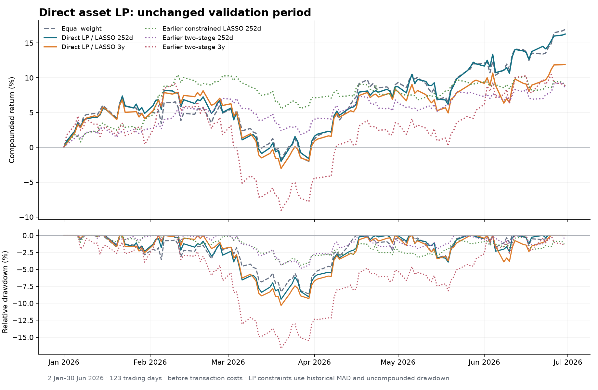

# LASSO 预测 + 直接资产线性规划

> 保留的三年窗口研究记录。清理后仅保留涉及三年训练、预测或风险窗口的研究产物；重复的纯 252 天回归对照已从结果目录和汇总表移除。正文与原图中的对照数值保留为当时的研究背景，当前 252 天结果请以[最新统一报告](unified-252-2026-09-22.md)为准。原始元数据/冻结配置未改写；历史审计记录描述清理前的完整实验，保留子集另有清理核验。


实验日期：2026-09-22。目标是直接根据预测收益与历史风险求解 98 个资产的每日持仓，不再训练三个候选组合的配比系数。保留 252 天和三年预测器，与此前两阶段方案、直接 U 候选、旧约束 LASSO 和 EW 在同一验证区间比较。

## 决策层是什么

预测器仍是六个滞后特征的逐资产 LASSO。每个窗口的 alpha 在截至 2024-07-31 的末三组 21 日时间顺序 CV 中确定，之后冻结，每天仅重估预测系数与标准化参数。
决策层没有可训练的回归参数、epoch 或早停；每天直接使用 HiGHS 求解新的 98 维持仓。

纯线性规划无法直接把标准差、标准 Sharpe 和复利收益同时当作线性表达式。因此本实现明确使用可线性化的风险约束，完整的实际表现单独评价。
收益—风险权衡的 LP 形式参考 [MOSEK 风险度量说明](https://docs.mosek.com/portfolio-cookbook/riskmeasures.html)与[回撤组合的线性规划表示](https://portfoliooptimizationbook.com/book/10.5-drawdown-portfolios.html)。

## 目标与约束

当天的预测收益向量为 mu，持仓为 w。R 只包括此前至多三个日历年的原始日收益；C 是 R 沿时间累加得到的矩阵，A 是逐列减去历史均值后的 R。

```text
maximize mu @ w

sum(w) = 1
sum(abs(w)) <= 1.5
abs(w_i) <= 0.05 for every asset
1 + R_s @ w >= 1e-6 for every historical day

MAD(w) = mean(abs(A @ w))
MAD(w) <= MAD(EW)

P_s(w) = C_s @ w
DD_sum(w) = max_s(max(0, P_1(w), ..., P_s(w)) - P_s(w))
DD_sum(w) <= DD_sum(EW)
```

MAD 是平均绝对偏差，**不是标准差**。DD_sum 是累计简单收益的绝对回撤，以初始本金为单位，**不是复利净值的相对回撤**。两者的 EW 上限都在当日相同历史窗口中计算。全局总敞口与单资产上限分别限制杠杆和集中度。

绝对值和峰值用辅助变量变为线性约束。例如：

```text
m_s >= A_s @ w, m_s >= -(A_s @ w)
mean(m) <= MAD(EW)

peak_0 = 0
peak_s >= peak_(s-1)
peak_s >= C_s @ w
peak_s - C_s @ w <= DD_sum(EW)
```

初始峰值必须包含零，否则窗口刚开始的损失会被漏计。解出主问题后，用第二个 LP 在预测日收益损失不超过 1e-10 的范围内最小化距 EW 的 L1 距离，以处理数值并列；这不引入可学习的混合系数。
求解后直接从实际持仓重算所有约束，不仅相信辅助变量。无可行解或数值验证失败会明确报错，不自动替换成 EW。

这里的历史回撤是假设当天拟定的 w 在此前历史中保持固定配比、每天再平衡得到的压力指标，与策略实际逐日变化的持仓路径不同。它不能保证未来回撤受同一上限约束。

## 时间与公平比较

- 原始历史从 2021-08-01 起，实际首条为 2021-08-02；预处理继续删除指定两列，保留 98 个资产。
- LASSO alpha 校准截止 2024-07-31，沿用晚期 3 × 21 日时间顺序 CV；首 63 条历史只用于特征预热。
- 2024-08-01 至 2025-12-31 不逐日回测：决策层没有需要训练的模型参数。此前历史仍可进入后续日期的滚动训练和风险窗口。
- 原验证期：2026-01-02 至 2026-06-30，共 123 日。
- 最终测试仍保留 2026-08-01 至 2026-08-30，本轮未使用。当前 CSV 截至七月底。
- 四条 LP 策略使用相同风险设置：252 天 LASSO、三年 LASSO，以及两个同窗口历史均值预测对照。
- 本轮 LP 上限固定，不按新验证结果重新选择。以默认配置得出的负面结果也保留。

默认只求解验证期的 123 日持仓。可通过 `--include-development` 额外回测开发期，但本轮未运行；跳过开发期求解不改变验证期持仓。

比较表采用实际日收益，复利累计收益、日样本标准差（ddof=1）、日 Sharpe（rf=0，不年化）、最大相对回撤。换手率相对上一日收益漂移后的持仓计算，验证期首日从 EW 开始；均未扣交易成本。
此前的 U 已经直接最大化预测收益，但使用 Ledoit–Wolf 标准差约束且没有 5% 集中度上限。因此新旧 U 的差异来自风险约束与集中度限制，不能全归因于取消组合层。

## 验证结果

以下均为 2026-01-02 至 2026-06-30 的 123 个交易日，未扣交易成本。`Baseline` 是原最小方差回归 LASSO；`U` 是上一轮直接最大化预测收益的候选组合；`Sharpe` 和 `ReturnVolatility` 是上一轮训练的混合决策层。

| 模型 | 累计收益 | 日 Sharpe | 日波动 | 最大回撤 |
|---|---:|---:|---:|---:|
| LP_LASSO_252d | 16.27% | 0.1265 | 1.01% | -9.41% |
| LP_Mean_252d | 16.98% | 0.1320 | 1.00% | -9.05% |
| LP_LASSO_3y | 11.89% | 0.0994 | 0.97% | -10.31% |
| LP_Mean_3y | 11.47% | 0.0966 | 0.96% | -10.30% |
| EW | 16.93% | 0.1325 | 1.00% | -8.63% |
| Baseline_252d | 6.98% | 0.0995 | 0.57% | -4.83% |
| Baseline_252d_Constrained | 8.80% | 0.1223 | 0.57% | -4.40% |
| Baseline_3y | 8.46% | 0.1192 | 0.57% | -5.21% |
| Baseline_3y_Constrained | 7.76% | 0.1051 | 0.60% | -5.33% |
| LASSO_252d_U | 9.48% | 0.0739 | 1.07% | -10.38% |
| LASSO_3y_U | 8.88% | 0.0592 | 1.31% | -16.65% |
| LASSO_252d_Sharpe | 8.57% | 0.1192 | 0.57% | -4.87% |
| LASSO_252d_ReturnVolatility | 8.57% | 0.1192 | 0.57% | -4.87% |
| LASSO_3y_Sharpe | 8.88% | 0.0592 | 1.31% | -16.65% |
| LASSO_3y_ReturnVolatility | 8.88% | 0.0592 | 1.31% | -16.65% |



252 天预测 + LP 的累计收益 16.27%，比原约束 252 天 LASSO 的 8.80% 高，但日波动由 0.57% 升至 1.01%，最大回撤由 -4.40% 扩至 -9.41%。日 Sharpe 仅从 0.1223 提升至 0.1265，因此收益提升伴随明显更高的风险，不能解释为全面改进。

相较上一轮的直接 U 候选，新 LP 在两个预测窗口都提高了累计收益和 Sharpe，并降低了实际波动与回撤。三年模型相较上一轮混合模型也改善：累计收益由 8.88% 至 11.89%，Sharpe 由 0.0592 至 0.0994，最大回撤由 -16.65% 至 -10.31%。由于 MAD/回撤约束和单资产 5% 上限一起改变，本轮不能分离各项改动的贡献。

EW 仍是更强的综合基准：累计收益 16.93%、Sharpe 0.1325、最大回撤 -8.63%，均优于两个 LASSO + LP 主模型。新方案尚未证明优于 EW。

## 预测贡献与持仓诊断

同一 LP 换成 252 天历史均值预测，累计收益达到 16.98%，Sharpe 0.1320，最大回撤 -9.05%，好于 252 天 LASSO + LP。252 天 LASSO 的验证 MSE 为 0.000201465，历史均值为 0.000200963，后者也稍好。历史均值相对 EW 的收益优势只有约 0.043 个百分点，并不足以抵消更差的回撤和换手表现。

三年 LASSO + LP 的收益略高于对应历史均值 + LP（11.89% 对 11.47%），但两者预测 MSE 几乎相同（约 0.000201135 对 0.000201137）。这些对照没有显示稳定、显著的 LASSO 预测增益。

四条 LP 策略每天的总敞口均接近上限 1.5，单资产绝对权重不超过 5%。252 天 LASSO + LP 在约 99.2% 的验证日期触及历史 MAD 上限，在约 65.9% 的日期触及历史简单累计收益回撤上限。尽管这些历史约束逐日通过，其验证期真实回撤仍超过 EW，说明历史风险上限与未来实际风险是不同概念。

按半个持仓 L1 变动定义，252 天 LASSO + LP 的平均日换手为 18.14%，对应历史均值为 8.71%；三年 LASSO + LP 为 8.18%，EW 为 0.33%。LP 目标使用预测均值，预测变化会直接影响最优持仓，因此收益之外也需要关注换手成本。

## 交易成本敏感性与验证

按 `日净收益 = 日毛收益 - 2 × 换手率 × 单边费率` 作说明性估算，再计算复利累计收益。费率未用于选模型或调参，也不代表具体可执行产品的真实成本。

| 模型 | 未扣成本 | 单边 5 bps | 单边 10 bps |
|---|---:|---:|---:|
| LP_LASSO_252d | 16.27% | 13.71% | 11.20% |
| LP_Mean_252d | 16.98% | 15.73% | 14.50% |
| LP_LASSO_3y | 11.89% | 10.77% | 9.67% |
| LP_Mean_3y | 11.47% | 10.44% | 9.41% |
| EW | 16.93% | 16.88% | 16.84% |

252 天 LASSO + LP 对成本尤其敏感：单边 10 bps 的示例中，累计收益由 16.27% 降至 11.20%。历史均值对照的较低换手值得保留比较。

验证证据：118 项仓库测试通过；独立代码审查无未解决问题；40 个随机小规模 LP 与全配对回撤表达式一致。结果审计重算 123 日 × 5 条策略的收益、换手和风险约束，并核对 10 个既有策略的持仓与收益。另用 CVXPY/CLARABEL 求解 6 个真实主问题，最大目标差异约 1.27e-12。运行前、导出时与审计时的数据和代码指纹一致。

审计的数学最优性针对给定预测与历史约束；它不证明收益预测正确或未来投资表现最优。完整指标和核验结果保存在 `results/window_studies_3y/forecast_lp_20260922/`。

本轮固定风险设置，只运行验证期；没有根据此次结果重新选参数。该验证期已用于此前多轮研究，因此结果属于开发比较，不能代替未使用的最终测试。


## 模块与复现

| 文件 | 职责 |
|---|---|
| `portfolio/linear_decision.py` | LP 设置、历史风险约束、HiGHS 求解和独立可行性检查 |
| `portfolio/direct_lp.py` | 因果预测、每日直接持仓、指标与冻结测试 |
| `portfolio/lp_reference.py` | 验证既有结果来源并重构收益后比较 |
| `run_direct_lp.py` | 命令行和文件导出 |

```bash
OPENBLAS_NUM_THREADS=1 OMP_NUM_THREADS=1 .venv/bin/python run_direct_lp.py \
  --reference results/window_studies_3y/forecast_mixture_20260922 \
  --output results/window_studies_3y/forecast_lp_20260922
```

比较前检查原始 CSV 哈希、开发历史指纹、共享时间/CV/预测/风险设置、相关代码哈希，并由此前持仓独立重构收益。参考结果只参与比较，不用于生成新的 LP 持仓。
历史窗口仍通过 TrainingConfig/TrainingWindow 配置。LP 限额集中在 LPConstraints；CLI 暴露 position-limit、mad-ratio、drawdown-ratio。原有 126/252 天、三年和混合决策流程均保留。

冻结配置记录选中 alpha、风险设置、资产顺序、历史指纹、相关代码和数值库版本。八月入口必须显式传入该配置且覆盖全部 20 个预期交易日；不重新选择参数。
