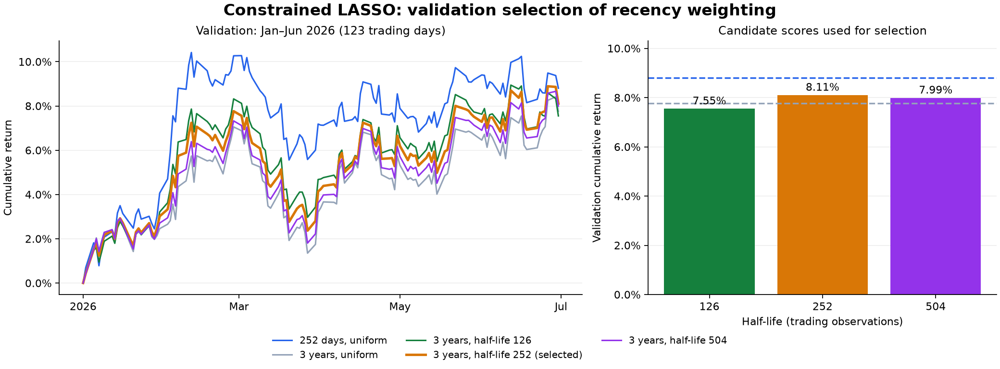

# 三年加权约束 LASSO：验证集选择近期权重

> 保留的三年窗口研究记录。清理后仅保留涉及三年训练、预测或风险窗口的研究产物；重复的纯 252 天回归对照已从结果目录和汇总表移除。正文与原图中的对照数值保留为当时的研究背景，当前 252 天结果请以[最新统一报告](unified-252-2026-09-22.md)为准。原始元数据/冻结配置未改写；历史审计记录描述清理前的完整实验，保留子集另有清理核验。


实验日期：2026-09-22。目标是在三年训练窗口和原有硬约束下，通过调整近期样本权重改善累计收益。
下面的成绩来自用于选择半衰期的验证集，存在选择偏差，不能视为独立测试结果。

## 固定模型与唯一搜索参数

保留固定 `lambda=1e-5` 的 LASSO，线性参数化 `w = EW - N @ beta` 不变。
每个预测日只使用此前最多三个日历年的收益；最新观察值的年龄为 0。
唯一调整的参数是指数样本权重的半衰期 h，单位为交易观察值：

```text
raw_weight_i(h) = 2^(-age_i / h)
q_i(h) = raw_weight_i(h) / sum(raw_weight(h))
weighted_mean = sum(q_i * R_i @ w)
Loss = sum(q_i * (R_i @ w - weighted_mean)^2) + 1e-5 * sum(abs(beta))
```

继续使用三个硬约束：

- 总敞口 `sum(abs(w)) <= 1.5`，权重和结构性地等于 1。
- 加权训练波动不超过同窗口、同一组样本权重计算的 EW 波动。
- 对每个历史场景要求 `1 + R_i @ w >= 1e-6`。

收益奖励、额外敞口惩罚和事后 EW 混合均为零，LASSO 强度、三年窗口和约束限额不参与选择。
这里调整的是训练样本的重要性，最终资产持仓仍由约束优化求解。

## 验证流程

预先固定三个候选：h 为 126、252、504，约对应半年、一年、两年的半衰期。
每个候选独立完成同一验证区间的全部滚动拟合，然后按累计收益最大值选择；累计收益精确相同时优先较长半衰期。
网格不根据运行结果扩展，不在三个候选之间逐日选择事后赢家。这个有限网格没有启用额外早停，也没有修改求解器停止条件。

两个等权对照——252 天约束版、三年约束版——仅用于比较，不参与半衰期选择。
如果最佳加权候选未超过对照，仍如实报告，不自动宣称有改进。

- 历史池保持 2021-08-01 至 2026-07-31，实际 1255 条观察值、98 个资产。
- 本次只在原验证期 2026-01-02 至 2026-06-30 选择权重，共 123 个交易日；未重新搜索更长开发区间。
- 每天拟合严格排除预测当天；过去已发生的验证日收益可进入后续日期的训练窗口。
- 第一日的三年训练历史为 2023-01-03 至 2025-12-31。三个加权候选在每个预测日使用相同历史行，只改变样本权重。
- 七月和最终 2026-08-01 至 2026-08-30 测试区间不参与权重选择，现有数据也尚未覆盖八月。
- 各候选验证期收益以实际逐日持仓计算，不对评价收益施加近期样本权重；累计收益采用复利，Sharpe 为日频，未扣交易成本或减去无风险利率。

实现位于 `run_weight_tuning.py`，复用 `TrainingConfig`、现有约束求解器、回测函数以及 `run_lasso_windows.py` 的策略/指标辅助函数。
旧的 126/252 天用法和 `3y_weighted` 默认半衰期 252 均保留；选中设置单独写入 `selection.json`，不自动覆盖原预设。

## 验证结果

**三档中选出 h=252，累计收益为 8.11%。** 这是权重半衰期 252 个交易观察值，训练窗口仍然是三年。
原 `3y_weighted` 的预设半衰期就是 252，因此本次验证没有选择更强或更弱的衰减，也没有产生相对于原半衰期的额外调参收益。

| 方法 | 累计收益 | 日 Sharpe | 日波动 | 最大回撤 | 平均总敞口 |
|---|---:|---:|---:|---:|---:|
| 252 天等权 + 约束（对照） | 8.80% | 0.1223 | 0.5743% | -4.40% | 1.500 |
| 三年等权 + 约束（对照） | 7.76% | 0.1051 | 0.5951% | -5.33% | 1.500 |
| 三年加权 + 约束，h=126 | 7.55% | 0.1097 | 0.5534% | -4.94% | 1.500 |
| 三年加权 + 约束，h=252（选中） | 8.11% | 0.1159 | 0.5606% | -5.01% | 1.500 |
| 三年加权 + 约束，h=504 | 7.99% | 0.1119 | 0.5734% | -5.14% | 1.500 |

与三年等权约束版相比，选中配置的累计收益从 **7.76% 提高到 8.11%**，约增加 **0.34 个百分点**；
日 Sharpe 从 **0.1051 升至 0.1159**，日波动从 **0.5951% 降至 0.5606%**，最大回撤从 **-5.33% 改善至 -5.01%**。

但它仍未超过 252 天训练窗口的等权约束版：后者累计收益 **8.80%**、日 Sharpe **0.1223**、最大回撤 **-4.40%**。
新配置的日波动较低（0.5606% 对 0.5743%），因此收益、波动和回撤应分别比较。

h=252 相对 h=504 的累计收益只高约 **0.11 个百分点**。本次只是三个候选中的验证期排序，不能据此断言 252 是普遍最优半衰期。



## 权重调整具体改变了什么

| 三年训练配置 | 最近一个日历年的平均权重占比 | 平均有效样本数 |
|---|---:|---:|
| 三年等权 + 约束（对照） | 33.4% | 751.5 |
| 三年加权 + 约束，h=126 | 76.0% | 352.1 |
| 三年加权 + 约束，h=252（选中） | 57.0% | 563.8 |
| 三年加权 + 约束，h=504 | 45.3% | 691.1 |

这里的最近一年严格按每个预测日前一个日历年统计，权重占比为 123 个训练窗口的平均值。
有效样本数为 `1 / sum(q_i^2)`；实际每个三年窗口约有 750 多条观察值。
选中方案给最近一年约 **57%** 的训练权重，有效样本数约 **564**。
半衰期 126 的近期权重更集中、有效样本数更少，本次没有带来更高累计收益；504 的历史权重更平均，收益略低于 252。

对选中方案独立检查，总敞口最大值为 **1.499999917**，所有窗口均接近 1.5 边界（误差小于 `1e-5`）。
加权训练波动 / 同权重 EW 波动最大为 **0.5922**，最小训练财富倍数为 **0.9427**。
三项约束均满足，收益奖励和敞口惩罚均为零。

作为跨轮参考：上一轮相同 h=252 的三年加权无约束模型，原验证期累计收益为 **7.59%**；
本次同半衰期加入约束后为 **8.11%**。这个变化来自加入约束，不是改变了半衰期。
两轮使用同一数据哈希、相同日期和固定 LASSO 强度，但无约束版本的总敞口更高，不应只比较收益而忽略持仓限制。

## 可靠性检查与使用边界

- 完整 **66 项自动测试**通过，独立代码审查未发现需要修复的问题。
- 新增测试以两资产问题独立推导加权 LASSO 解，复核权重衰减、正则项尺度、最终持仓、加权 EW 风险限额与选择指标。
- 将验证结束之后全部收益改为缺失标记，拟合权重和所选配置保持一致；日期校验也禁止把七月或八月纳入选择。
- 五个候选/对照共 **615 次拟合**均由 Clarabel 返回 `optimal`，全部通过约束可行性复核。
- 独立重算所有日收益、收益指标、615 个窗口的归一化权重、加权方差、目标值和约束，以及最终候选排序。
- 最大日收益重构差异 **1.28e-16**，最大目标重算差异 **2.30e-19**。
- 两个等权对照与上一轮保存的持仓完全一致，所有运行时源代码哈希与复核时文件一致。

当前验证期已经用于多轮模型比较，本轮又用它选择了半衰期，成绩有选择偏差。有限三个候选减少了搜索范围，但不证明过拟合已经解决。
若以后使用选中方案，应冻结 h=252、LASSO 强度与约束，按既定规则滚动拟合，再在尚未参与选择的最终测试期评价。
本轮没有消耗最终八月测试，也没有根据 123 天的排序继续扩展网格。

## 复现和复用配置

```bash
OPENBLAS_NUM_THREADS=1 OMP_NUM_THREADS=1 python run_weight_tuning.py --output results/lasso_3y_weight_tuning_reproduction
python -m unittest discover -s tests -v
```

`results/window_studies_3y/lasso_recency_20260922/` 包含每个候选/对照的收益、持仓、训练诊断、汇总表、运行元数据和独立复核 `verification.json`。
选中配置保存在 `selection.json`，可以保持原训练流程并复用：

```python
import json
from pathlib import Path
from portfolio import TrainingConfig, TrainingWindow

selected = json.loads(Path("results/window_studies_3y/lasso_recency_20260922/selection.json").read_text())
settings = selected["training"]
config = TrainingConfig(TrainingWindow(**settings["window"]), half_life=settings["half_life"])
# 继续将 config.window 交给 backtest，config.sample_weights 交给现有约束拟合函数。
```

数据 SHA-256：`11399a830c7b2a192d652b39e866a74c05d7380dd6edf1573ce1c40f9d271c23`。完整参数、软件版本与代码哈希保存在 `run_metadata.json`。
