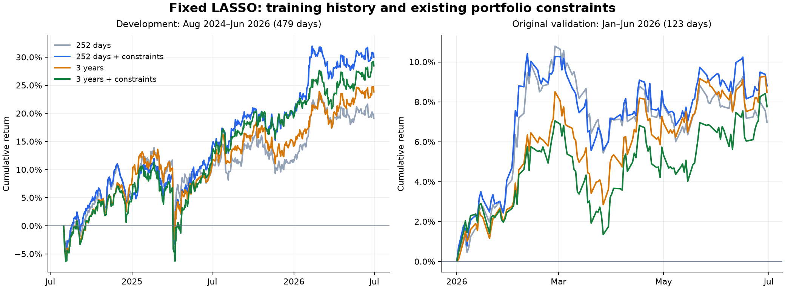

# 三年等权 LASSO + 原有硬约束

> 保留的三年窗口研究记录。清理后仅保留涉及三年训练、预测或风险窗口的研究产物；重复的纯 252 天回归对照已从结果目录和汇总表移除。正文与原图中的对照数值保留为当时的研究背景，当前 252 天结果请以[最新统一报告](unified-252-2026-09-22.md)为准。原始元数据/冻结配置未改写；历史审计记录描述清理前的完整实验，保留子集另有清理核验。


实验日期：2026-09-22。沿用五年历史设置，比较训练窗口长度与原有约束的组合；以下均为开发/验证结果，最终八月测试没有运行。

## 设计与实现

模型仍是固定强度 `lambda=1e-5` 的 LASSO：

```text
w = EW - N @ beta
Loss = variance(R @ w) + 1e-5 * sum(abs(beta))

sum(w) = 1
sum(abs(w)) <= 1.5
variance(R @ w) <= variance(R @ EW)
1 + R_i @ w >= 1e-6, for every training observation i
```

LASSO 惩罚作用于回归系数 beta，硬约束作用于最终资产持仓 w。净持仓和为 1 时，总敞口上限 1.5 对应总多头最多 1.25、总空头最多 0.25。
收益奖励和额外敞口惩罚均显式设为零，即 `reward_strength=0`、`exposure_strength=0`；这不是此前调参得到的 gamma=2 版本。

窗口设置与约束设置保持分离：`TrainingConfig` 决定观察历史和样本权重，`--constrained` 为每个所选预设增加一个约束对照。
约束版直接调用现有 `fit_portfolio_growth`，使用原来的 `PortfolioConstraints` 和可行性检查，未修改目标函数实现或求解器。
优先使用 Clarabel，失败或数值检查未通过时由原实现尝试 SCS；不接受未通过实际约束复核的结果。
原来的 126 天、252 天和三年预设、无约束模式、CV 和其他实验入口仍保留。

## 数据与比较口径

- 可用历史：2021-08-01 至 2026-07-31，实际 1255 个交易日、98 个资产。
- 三年版本使用 `[预测日 - 3个日历年, 预测日)` 内的全部历史，样本等权；每天实际 750–755 条训练观察值。
- 252 天版本使用预测日之前 252 条观察值，样本等权。
- 固定同一 LASSO 强度，不进行 CV 或超参数搜索，也不进行事后 EW 混合。
- 扩展开发区间：2024-08-01 至 2026-06-30，共 479 天。
- 原验证区间：2026-01-02 至 2026-06-30，共 123 天，单独输出以便与之前的结果比较。
- 最终测试仍为 2026-08-01 至 2026-08-30，不参与本次实验；现有 CSV 尚未覆盖该期。
- 收益按照每日真实持仓和当天资产收益计算，随后复利累计；波动和 Sharpe 使用日收益，未扣交易成本，未减无风险利率。

同一窗口比较有/无约束，识别约束的效果；同一约束比较 252 天/三年，识别更长训练历史的效果。两种变化的收益贡献不能简单相加。

## 结果判断

**三年等权 + 原有约束没有超过 252 天约束版。** 在原半年验证期，它也低于三年无约束版：累计收益从 8.46% 降至 7.76%，日 Sharpe 从 0.1192 降至 0.1051。
在扩展开发区间，约束提高了三年模型的累计收益，但日波动和最大回撤上升；它仍低于 252 天约束版。
因此，更长训练窗口与约束的收益提升不能直接叠加。

## 原验证区间：2026-01-02 至 2026-06-30

| 方法 | 累计收益 | 日 Sharpe | 日波动 | 最大回撤 | 平均总敞口 |
|---|---:|---:|---:|---:|---:|
| 252 天 LASSO | 6.98% | 0.0995 | 0.5673% | -4.83% | 3.036 |
| 252 天 LASSO + 约束 | 8.80% | 0.1223 | 0.5743% | -4.40% | 1.500 |
| 三年等权 LASSO | 8.46% | 0.1192 | 0.5678% | -5.21% | 2.746 |
| 三年等权 LASSO + 约束 | 7.76% | 0.1051 | 0.5951% | -5.33% | 1.500 |

相对三年无约束版，新增约束使累计收益降低约 **0.70 个百分点**，平均总敞口从 **2.746 降至 1.500**，但日波动从 0.5678% 升至 0.5951%，最大回撤从 -5.21% 扩大至 -5.33%。
相对 252 天约束版，三年约束版累计收益低约 **1.04 个百分点**，Sharpe 更低、波动更高、最大回撤更大。
这轮比较不支持用三年约束版替换 252 天约束版。

## 扩展开发区间：2024-08-01 至 2026-06-30

| 方法 | 累计收益 | 日 Sharpe | 日波动 | 最大回撤 | 平均总敞口 |
|---|---:|---:|---:|---:|---:|
| 252 天 LASSO | 19.11% | 0.0514 | 0.7684% | -12.68% | 2.945 |
| 252 天 LASSO + 约束 | 30.02% | 0.0725 | 0.8005% | -13.66% | 1.500 |
| 三年等权 LASSO | 23.82% | 0.0607 | 0.7858% | -14.20% | 2.885 |
| 三年等权 LASSO + 约束 | 28.46% | 0.0663 | 0.8421% | -15.78% | 1.500 |

三年约束版相对三年无约束版的累计收益增加约 **4.64 个百分点**，从 23.82% 升至 28.46%；
但仍低于 252 天约束版的 30.02%，最大回撤也更大（-15.78% 对 -13.66%）。
整个区间的收益改善与原验证半年的下降同时成立，说明效果依赖评估阶段。



## 分阶段累计收益

| 方法 | 2024-08 至 2024-12 | 2025 全年 | 2026 上半年 |
|---|---:|---:|---:|
| 252 天 LASSO | 5.53% | 5.50% | 6.98% |
| 252 天 LASSO + 约束 | 4.74% | 14.09% | 8.80% |
| 三年等权 LASSO | 7.32% | 6.37% | 8.46% |
| 三年等权 LASSO + 约束 | 4.49% | 14.09% | 7.76% |

各段分别包含 106、250、123 个交易日，并重新从初始财富 1 计算。
三年约束版在 2025 年的提升较大，但在 2024 年后五个月和 2026 年上半年均低于三年无约束版。

## 约束是否实际生效

对三年约束版全部 479 个窗口独立检查：

- 总敞口最大值为 **1.499999952**，全部窗口与 1.5 上限的差均小于 `1e-5`。总敞口限制持续处于边界附近。
- 训练波动 / 同窗口 EW 波动的最大值为 **0.6045**，明显低于上限 1。
- 所有训练场景的最小财富倍数为 **0.9391**，明显高于下界 `1e-6`。
- 所有窗口的收益奖励和额外敞口惩罚均为零。

这些结果表明，此次主要限制解的是总敞口上限，波动上限和财富下界留有较大余量。
降低总敞口不保证降低样本外波动：在多空组合中，部分空头承担对冲作用，限制它们会改变组合的风险暴露。
这里未单独估计市场 Beta，不能将风险变化直接归因于某一个因子。
训练波动“不超过 EW”也不等于“不超过无约束 LASSO”，更不保证未来日波动下降。

## 验证与复现

- 完整 **62 项自动测试**通过。新增两资产测试使用 `B=2*A` 的独立解析边界，验证约束最优持仓约为 `[1.25, -0.25]`，并独立计算方差、LASSO 目标及财富下界。
- 独立代码审查通过，核对了零奖励/零敞口惩罚、约束路由、对照保留和按策略记录的元数据。
- 两个约束版本共 **958 次拟合**均由 Clarabel 返回 `optimal`，并通过原求解器的实际持仓可行性检查。
- 此外，从导出持仓与原始数据独立重算了所有日收益、两个评价区间的累计收益/波动/Sharpe/回撤，以及 958 个窗口的约束值和目标值。
- 最大逐日收益重构误差为 **2.91e-16**；约束目标重算最大差异为 **2.44e-19**。
- 两个无约束对照与上一轮导出持仓完全一致；252 天约束版与原 最新统一 252 天基准目录 `results/unified_252/20260922T122949.119118Z/baselines/` 的全部 123 个验证日持仓完全一致。
- 最终八月测试没有使用。以上结果是开发比较，不能据此认定任一方法已解决过拟合。

```bash
OPENBLAS_NUM_THREADS=1 OMP_NUM_THREADS=1 python run_lasso_windows.py --presets 252d 3y --constrained --output results/lasso_windows_constrained_reproduction
python -m unittest discover -s tests -v
```

结果目录：`results/window_studies_3y/lasso_constraints_20260922/`。
`summary.csv` 对应完整 479 天，`validation_summary.csv` 对应原 123 天；每个策略另外输出收益、持仓与训练诊断。
`run_metadata.json` 保存参数、数据/源代码哈希和依赖版本，`verification.json` 保存独立复核结果。
数据 SHA-256：`11399a830c7b2a192d652b39e866a74c05d7380dd6edf1573ce1c40f9d271c23`。
