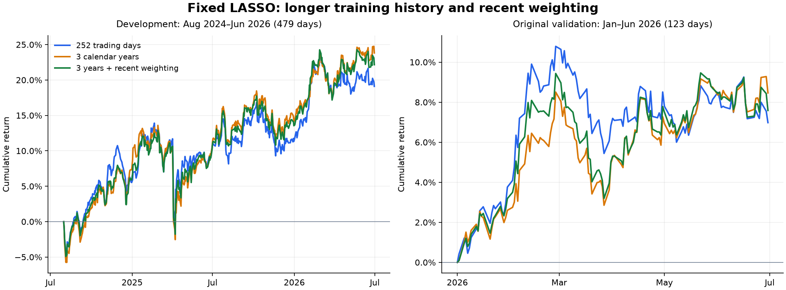

# 五年历史：LASSO 训练窗口与近期加权实验

> 保留的三年窗口研究记录。清理后仅保留涉及三年训练、预测或风险窗口的研究产物；重复的纯 252 天回归对照已从结果目录和汇总表移除。正文与原图中的对照数值保留为当时的研究背景，当前 252 天结果请以[最新统一报告](unified-252-2026-09-22.md)为准。原始元数据/冻结配置未改写；历史审计记录描述清理前的完整实验，保留子集另有清理核验。


实验日期：2026-09-22。以下均为滚动开发/验证结果，最终八月测试没有运行。

在原 2026 年上半年验证区间，252 天 LASSO 累计收益为 **6.98%**，三年等权为 **8.46%**，三年近期加权为 **7.59%**。
延长训练窗口在本次比较中提高了累计收益和日 Sharpe；近期加权进一步降低了日波动，但没有超过三年等权的累计收益。
三年版本在该半年区间的最大回撤均大于 252 天 baseline，不能将结果概括为所有风险指标都改善。

## 实验范围

- 五年历史范围：2021-08-01 至 2026-07-31。实际第一条交易记录为 2021-08-02，共 1255 天、98 个资产；指定两列仍在预处理最开始删除。
- 前三年用于准备初始训练历史，滚动开发评价为 2024-08-01 至 2026-06-30，共 479 天。
- 原验证区间保留为 2026-01-02 至 2026-06-30，共 123 天，用于与已有结果直接比较。
- 七月数据只作为后续测试的可用历史，本次评价止于六月底。最终测试仍为 2026-08-01 至 2026-08-30；当前 CSV 尚未包含该测试期。
- 每天重新拟合，训练数据严格早于持有日。已经发生的开发/验证收益可进入随后日期的历史窗口；这符合预先确定的逐日滚动规则。
- 固定 LASSO 强度 `lambda=1e-5`，对应 sklearn `alpha=5e-6`。本次不搜索 lambda，不启用收益奖励、额外敞口/波动限制或事后 EW 混合，只有结构性的权重和为 1。
- 此前讨论的 3×21 时间 CV 尚未加入本次固定 LASSO 比较，现有 CV 入口保持原状。

## 训练设置与封装

`portfolio/splits.py` 的 `TrainingWindow` 管理两种边界：固定交易观察值数量，或最多指定日历年数。
`portfolio/config.py` 的 `TrainingConfig` 只组合窗口和样本权重，提供 `126d`、`252d`、`3y`、`3y_weighted` 四个预设。
`run_lasso_windows.py` 从预设取得 `window` 和 `sample_weights`，调用原有 `backtest` 与 `fit_portfolio`。
原 126/252 天调用方式、底层默认 126 天和旧脚本均保留；没有复制 LASSO 求解器或回测循环。

对于持有日 t，三年窗口为 `[t - 3个日历年, t)`，包含周年边界、排除当天。
实际每次使用 750–755 个交易观察值，并非固定 756 行。三年预设要求至少 252 个观察值；
自定义较早起点可以使用不足三年的历史，默认起点则已经预留完整三年。

第一次开发期预测在 2024-08-01：三年模型训练日期为 2021-08-02 至 2024-07-31，共 754 天。
原验证期第一次预测在 2026-01-02：三年模型训练日期为 2023-01-03 至 2025-12-31，共 752 天；
252 天 baseline 仍使用 2024-12-30 至 2025-12-31。

近期加权使用 252 个交易观察值的半衰期：

```text
raw_weight_i = 2^(-age_i / 252)
q_i = raw_weight_i / sum(raw_weight)
Loss = sum(q_i * (y_i - intercept - X_i @ beta)^2) + 1e-5 * sum(abs(beta))
w = EW - N @ beta
```

`age_i` 为距该训练窗口最新观察值的交易观察值数。最近一天原始权重为 1，
向前 252、504、756 个观察值的权重依次为 0.5、0.25、0.125。
由于截距不惩罚，加权残差 MSE 等价于组合收益的加权方差。
权重经归一化，窗口变长不会通过样本总权重机械改变 LASSO 惩罚强度。
三年加权版的有效样本数 `1 / sum(q_i^2)` 约为 563–565，大于 252 天等权，但小于三年等权。
评价阶段仍直接计算真实逐日组合收益和复利，不对回测结果施加近期样本权重。

## 原验证区间：2026-01-02 至 2026-06-30

| 方法 | 累计收益 | 日 Sharpe | 日波动 | 最大回撤 | 平均总敞口 |
|---|---:|---:|---:|---:|---:|
| 252 天等权 LASSO | 6.98% | 0.0995 | 0.5673% | -4.83% | 3.036 |
| 三年等权 LASSO | 8.46% | 0.1192 | 0.5678% | -5.21% | 2.746 |
| 三年近期加权 LASSO | 7.59% | 0.1098 | 0.5555% | -5.70% | 2.852 |

三年等权比 252 天 baseline 增加约 **1.49 个百分点**累计收益；三年近期加权增加约 **0.61 个百分点**。
近期加权的日波动最低，但最大回撤为 -5.70%，反而大于三年等权的 -5.21% 和 baseline 的 -4.83%。
因此“较低日波动”和“较小最大回撤”不能互相替代。

## 扩展开发区间：2024-08-01 至 2026-06-30

| 方法 | 累计收益 | 日 Sharpe | 日波动 | 最大回撤 | 平均总敞口 |
|---|---:|---:|---:|---:|---:|
| 252 天等权 LASSO | 19.11% | 0.0514 | 0.7684% | -12.68% | 2.945 |
| 三年等权 LASSO | 23.82% | 0.0607 | 0.7858% | -14.20% | 2.885 |
| 三年近期加权 LASSO | 22.16% | 0.0600 | 0.7423% | -12.99% | 2.902 |

在更长的开发区间，三年等权累计收益最高，近期加权居中；两者日 Sharpe 均高于 252 天 baseline。
相对三年等权，近期加权降低了日波动和最大回撤，但牺牲了累计收益。它的最大回撤仍略大于 252 天 baseline。



## 分阶段累计收益

| 方法 | 2024-08 至 2024-12 | 2025 全年 | 2026 上半年 |
|---|---:|---:|---:|
| 252 天等权 LASSO | 5.53% | 5.50% | 6.98% |
| 三年等权 LASSO | 7.32% | 6.37% | 8.46% |
| 三年近期加权 LASSO | 5.90% | 7.22% | 7.59% |

三段分别为 106、250、123 个交易日，各段重新从初始财富 1 计算。
三年等权在这三段的累计收益均高于 baseline；近期加权在 2025 年高于三年等权，但在其余两段较低。
这说明近期加权的相对收益随阶段变化，不能只根据半年排序判断普遍优劣。

## 验证与解释边界

- 完整 61 项自动测试通过，包括此前 51 项和此次 10 项。新增测试覆盖 126/252 兼容、日历/闰日边界、最小历史长度、未来数据扰动、实际加权拟合、日期限制和导出复现。
- 独立审查未发现需要修复的问题，并独立核对了加权方差、LASSO 目标和有效样本数。
- 从原始收益与导出持仓独立重算三个策略的 479 天收益及两个区间的累计收益、波动、Sharpe 和最大回撤；最大逐日收益差异为 3.26e-16。
- 使用提交前原版 `rolling_windows` 重新拟合 252 天 LASSO 的全部 123 个原验证日，持仓最大差异为 9.97e-17，属于浮点序列化精度。baseline 没有因重构改变。
- 结果支持继续研究较长窗口，但没有证明过拟合已经消除。上述区间均已用于开发比较，不是独立最终测试。
- 各方法均允许做空且未限制总敞口；LASSO 的稀疏系数不能视为杠杆约束。未扣交易成本、未使用无风险利率，Sharpe 为日频值。

数据 SHA-256：`11399a830c7b2a192d652b39e866a74c05d7380dd6edf1573ce1c40f9d271c23`。
软件版本和运行时各源文件哈希见 `run_metadata.json`。

## 复现与输出

```bash
OPENBLAS_NUM_THREADS=1 OMP_NUM_THREADS=1 python run_lasso_windows.py --output results/lasso_windows_reproduction
python -m unittest discover -s tests -v
```

只修改预设即可切换训练配置，例如 `--presets 126d 252d 3y_weighted`；自定义配置示例见 README。
完整导出位于 `results/window_studies_3y/lasso_windows_20260922/`：`summary.csv` 是 479 天开发区间，
`validation_summary.csv` 是原 123 天验证区间，每个策略另有逐日收益、持仓、训练诊断。
`verification.json` 保存独立复核结果。结果目录被 Git 忽略，本说明与图保留可阅读的实验记录。
