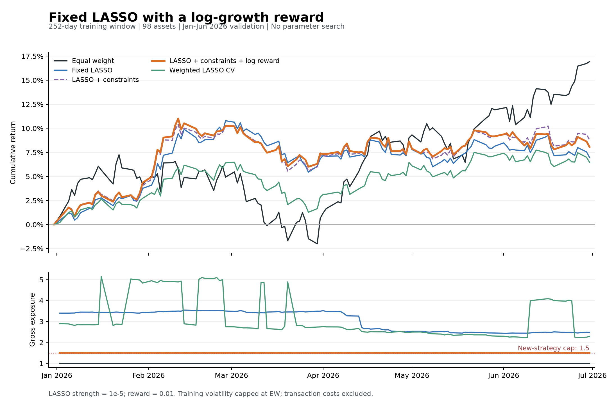

# 固定 LASSO 的对数收益奖励实验

实验日期：2026-09-17。本文记录第二验证集的探索结果，不是最终测试成绩。

**结果：完整新方案优于原始固定 LASSO，但仅加约束的对照更好。本次固定收益奖励没有带来额外改善。**

## 实验设置

| 设置 | 值 |
|---|---|
| 数据 | 98 个资产，已删除 ME9 BM10 和 BIG HiBM；数据截至 2026-07-31 |
| 训练窗口 | 252 个交易日，每日滚动，排除当天及未来收益 |
| 评价区间 | 2026-01-02 至 2026-06-30，共 123 个交易日 |
| LASSO 强度 | 固定 `Regularization("lasso", 1e-5)`，使用项目的归一化损失尺度 |
| 收益奖励 | eta=0.01，在回测前固定，不通过验证成绩调参 |
| 样本权重 | 均匀，不使用指数时间权重 |
| 事后组合调整 | 无，不进行 EW 混合 |
| 总敞口上限 | sum(abs(w)) <= 1.5，允许总空头最多 25% |
| 风险上限 | 每个训练窗口组合方差 <= 同窗口 EW 方差 |
| 对数定义域 | 每个训练场景 1 + R@w >= 1e-6，不裁剪非法收益 |
| 费用与指标 | 不计交易成本和无风险收益；Sharpe 为日均收益/日标准差，未年化 |

模型仍为 `w = EW - N@beta`。新训练目标是：

```text
variance(R @ w)
- 0.01 * mean(log1p(R @ w))
+ 1e-5 * sum(abs(beta))
```

收益奖励用实际组合收益 `R@w = y-X@beta`，不能使用减去截距后的残差。自由截距等于组合平均收益，因此方差项与原来含截距的平方损失一致。

对照组 `LASSO_Constrained` 保留相同约束，但设置 eta=0。它用于区分约束效应与奖励效应。原来的固定 LASSO 没有这些额外约束。

## 结果

| 策略 | 累计收益 | 日 Sharpe | 日波动率 | 最大回撤 | 平均总敞口 |
|---|---:|---:|---:|---:|---:|
| EW | 16.93% | 0.1325 | 0.9974% | -8.63% | 1.000 |
| MinVar | 2.94% | 0.0368 | 0.7074% | -4.61% | 8.921 |
| LASSO | 6.98% | 0.0995 | 0.5673% | -4.83% | 3.036 |
| Ridge | 5.10% | 0.0778 | 0.5389% | -4.93% | 3.125 |
| LASSO_CV | 4.74% | 0.0659 | 0.5981% | -4.86% | 3.800 |
| Ridge_CV | 3.76% | 0.0568 | 0.5550% | -5.15% | 4.576 |
| RidgeWeighted | 6.60% | 0.0923 | 0.5814% | -5.85% | 2.145 |
| LASSO_CV_Weighted | 6.48% | 0.0963 | 0.5452% | -4.89% | 3.177 |
| Ridge_CV_Weighted | 5.20% | 0.0805 | 0.5298% | -5.60% | 3.612 |
| LASSO_Constrained | 8.80% | 0.1223 | 0.5743% | -4.40% | 1.500 |
| LASSO_LogGrowth | 8.07% | 0.1133 | 0.5716% | -4.51% | 1.500 |



## 如何解释

1. **加入约束有效。** 原始固定 LASSO 的累计收益为 6.98%、日 Sharpe 为 0.0995；仅加约束后变为 8.80%、0.1223。平均总敞口从 3.036 降至约 1.5，最大回撤由 -4.83% 改善至 -4.40%。

2. **收益奖励本轮没有进一步改善结果。** 在相同约束下，加入 eta=0.01 后累计收益从 8.80% 降至 8.07%，减少 0.73 个百分点；日 Sharpe 从 0.1223 降至 0.1133。日波动率略降，但收益下降更多。不能把完整方案相对原始 LASSO 的改善都归因于新损失。

3. **完整方案的累计收益与 Sharpe 均高于此前的学习型策略。** 相比原始 LASSO，累计收益增加 1.09 个百分点，Sharpe 增加约 0.0138，最大回撤改善约 0.32 个百分点。日波动率从 0.5673% 略升到 0.5716%，因此不能描述为所有风险指标都改善。此次新增的仅约束对照表现更好。

4. **EW 仍是收益与 Sharpe 最高的组合。** EW 累计收益为 16.93%、日 Sharpe 为 0.1325；但日波动率为 0.9974%、最大回撤为 -8.63%，高于这些正则化组合的风险。

5. **实际起主要限制作用的是总敞口上限。** 两个新增策略的训练波动最多分别约为 EW 的 59.61% 和 59.93%，风险上限均未触界；财富下界也未触界。按距上限不超过 1e-5 的口径，仅约束策略和收益奖励策略分别有 113/123、121/123 天接近 1.5 的总敞口上限。这支持优先研究杠杆约束的贡献，而不是把结果解释成风险上限或收益奖励的成功。

收益奖励直接依赖历史收益估计，也可能追逐样本期内的赢家。这是解释当前表现的一种可能机制，并未由本轮实验单独证明。一个固定参数、单一评价区间的结果也不能证明长期优势或过拟合已经解决。

## 验证与数值处理

- 26 项自动测试通过，包括两资产独立网格最优解、零奖励与原求解器的一致性、奖励实际改变持仓、约束、未来数据隔离、备用求解器和端到端导出。
- 两位独立 agent 分别审查目标/约束/数值实现和运行入口/元数据/实验可比性，发现的问题已修复。
- 11 个策略各有 123 条每日收益和持仓；权重和均为 1；由导出 CSV 独立重算的指标与 summary 一致。
- 原九个策略与此前 a049f4e 运行的六项指标在数值容差内一致。此次未改变其参数与评分规则。
- 新策略全部窗口得到 optimal 状态，并通过总敞口、训练风险和对数定义域的实际数值复核。
- 仅加约束策略全部 123 天由 Clarabel 求解；收益奖励策略中 120 天由 Clarabel 求解，2026-03-11、2026-04-23、2026-06-26 由 SCS 重解同一个问题。没有用 EW 替代失败结果，也没有为了通过回测修改 lambda 或 eta。
- 新策略最大总敞口与 1.5 的数值误差在 1e-7 容差内。求解过程保存在每日 diagnostics 文件中。

当前环境：Python 3.12.10，NumPy 2.5.3，pandas 3.0.5，scikit-learn 1.9.1，CVXPY 1.9.2，Clarabel 0.11.1，SCS 3.3.1。

## 项目边界与已知限制

- 课程主验证指标仍是负 Sharpe，累计收益作为共同报告指标；本次没有用验证表现再次调整参数。
- 当前 RidgeCV 仍保留原来的 R² 默认评分，LassoCV 使用 MSE。课程文档讨论的 MSE 选参应单独对齐，不能将两者混称。
- 风险上限约束的是训练估计，不保证未来波动一定不超过 EW。
- 本地数据截至七月底。2026-08-01 至 2026-08-30 的最终测试集尚不可用，也未参与本轮选择。

## 复现

```bash
python -m pip install -r requirements.txt
python -m unittest discover -s tests -v
python run_example.py --weighted --growth --window 252 --reward-strength 0.01 --leverage-limit 1.5 --volatility-limit 1 --output results/growth_252_reproduction
```

输出目录必须是新目录或空目录，避免混合不同运行。当前完整结果位于 `results/growth_252/`：

- `summary.csv`：11 策略完整指标。
- `*_returns.csv`、`*_weights.csv`：逐日收益与持仓。
- `LASSO_Constrained_diagnostics.csv`、`LASSO_LogGrowth_diagnostics.csv`：逐日损失分项和约束检查。
- `run_metadata.json`：数据/代码 SHA-256、软件版本和实验设置。

数据 SHA-256：`11399a830c7b2a192d652b39e866a74c05d7380dd6edf1573ce1c40f9d271c23`。

原始数据和完整逐日输出遵循现有 .gitignore，不纳入版本控制；本报告及图表可以随代码提交。
