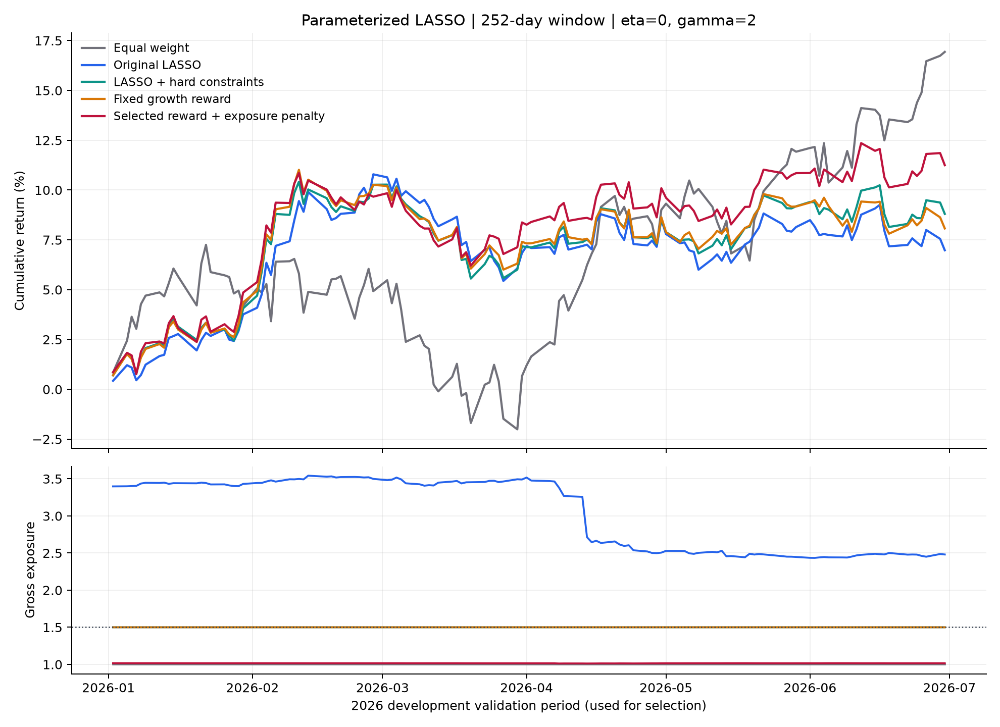

# 带参数的 LASSO + 约束 + 收益奖励

实验日期：2026-09-17。这里报告的是参与选参的开发/验证成绩，不是独立测试成绩。

最终选择 **eta=0、gamma=2**。累计收益 **11.25%**、日 Sharpe **0.1472**；相对原约束版累计收益变化为 **+2.44 个百分点**。

## 模型与实现

模型仍为 `w = EW - N @ beta`，每一天使用此前 252 个交易日，固定 LASSO 强度 `1e-5`。只选择收益奖励 eta 和敞口惩罚 gamma：

```text
Loss = variance(Rw) + 1e-5 * ||beta||_1
       - eta * mean(log(1 + Rw))
       + gamma * variance(R @ EW) * [max(0, (||w||_1 - 1)/0.5)]^2
```

仍保留总敞口 <=1.5、训练波动 <=EW、每个训练场景财富倍数 >=1e-6 的硬约束。敞口惩罚作用于实际持仓 w，LASSO 作用于 beta；均匀样本权重，无事后 EW 混合。gamma=0 保留之前的损失。每次拟合仍是凸优化，并独立复核求解结果的约束。

`portfolio/selection.py` 管理有限搜索；`run_tuning.py` 管理历史筛选、验证、冻结后的比较和导出。没有新增模型架构，也不同时搜索 LASSO 强度、窗口或硬约束上限。

## 数据与停止规则

- 98 个资产，预处理先删除指定两列；数据截至 2026-07-31。
- 历史筛选：2025-07-01 至 2025-12-31，128 个交易日，九个粗网格候选。选择 eta=0、gamma=1。
- 验证调整：2026-01-02 至 2026-06-30，123 个交易日；每个候选均评价完整区间。
- 最大 15 组不同的搜索配置；本次实际 12 组，两个时期共 15 次候选评价。相同配置在两个时期分别计算，不能将评价次数与不同参数数量混同。
- min_improvement=.002，即累计收益 0.2 个百分点；patience=1 个完整邻域批次。候选预算不允许截断批次。
- 验证阶段完成 1 轮邻域搜索；停止原因 `patience`：一轮完整邻域搜索未达到最低改善要求，触发早停。
- 局部搜索围绕累计收益最高配置展开；停止后，在距最高收益 .002 内的配置中依次优先较低 eta、较低实际平均总敞口、较低 gamma。原始最高分配置为 `{'reward_strength': 0.0, 'exposure_strength': 2.0}`，最终选择为 `{'reward_strength': 0.0, 'exposure_strength': 2.0}`。

这是**参数搜索早停**，不是提前中断凸求解器的训练迭代。它限制搜索预算与验证集使用次数，不保证全局最优，也不证明过拟合已经解决。

gamma 从 1 调到 2，验证累计收益仅由 11.2198% 提高到 11.2482%，约增加 0.0283 个百分点，低于 0.2 个百分点门槛，所以不再继续搜索。停止不意味着丢弃已算出的候选；gamma=2 同时具有更低的实际总敞口，按预先规定的选择规则保留。两者表现非常接近，不能据此断言 gamma=2 显著更好。

## 同区间比较

| 方法 | 累计收益 | 日 Sharpe | 日波动 | 最大回撤 | 平均总敞口 |
|---|---:|---:|---:|---:|---:|
| EW | 16.93% | 0.1325 | 0.9974% | -8.63% | 1.000 |
| LASSO | 6.98% | 0.0995 | 0.5673% | -4.83% | 3.036 |
| LASSO_Constrained | 8.80% | 0.1223 | 0.5743% | -4.40% | 1.500 |
| LASSO_LogGrowth | 8.07% | 0.1133 | 0.5716% | -4.51% | 1.500 |
| Selected_RewardOnly | 8.80% | 0.1223 | 0.5743% | -4.40% | 1.500 |
| Selected_ExposureOnly | 11.25% | 0.1472 | 0.6010% | -4.19% | 1.015 |
| LASSO_Selected | 11.25% | 0.1472 | 0.6010% | -4.19% | 1.015 |



所选 eta 为零，验证规则没有保留收益奖励。联合模型与所选仅敞口惩罚模型相同。 在所选 eta 下，加入额外敞口惩罚相对仅奖励的累计收益变化为 +2.44 个百分点。

相对原约束版，平均总敞口由 1.500 降到 1.015，最大回撤由 -4.40% 改善至 -4.19%；日波动却由 0.5743% 略升至 0.6010%。新配置的 Sharpe 高于 EW，但累计收益仍低于 EW 的 16.93%。因此改善应归于本次验证中的收益与实际持仓结构，不能概括成所有风险指标都下降。

上述单项消融在参数冻结后评价，不反馈给搜索。两项贡献不能简单相加，因为持仓重新优化后存在交互。本次收益、波动、Sharpe 和回撤必须分别解释，不能用累计收益提高推断所有风险指标都改善。

## 验证搜索记录

| 候选 | 轮次 | eta | gamma | 累计收益 | 平均总敞口 | 状态 |
|---:|---:|---:|---:|---:|---:|---|
| 1 | 0 | 0 | 0 | 8.80% | 1.500 | ok |
| 2 | 0 | 0.01 | 0 | 8.07% | 1.500 | ok |
| 3 | 0 | 0 | 1 | 11.22% | 1.029 | ok |
| 4 | 1 | 0.0015 | 1 | 11.00% | 1.029 | ok |
| 5 | 1 | 0 | 0.5 | 11.08% | 1.054 | ok |
| 6 | 1 | 0 | 2 | 11.25% | 1.015 | ok |

完整历史筛选与验证记录、每个成功候选的收益/持仓/训练诊断，以及元数据在 `results/parameterized_lasso_252/`。失败候选保留错误记录；失败比较明确标记，不用 EW 替代。本次比较失败记录为 `{}`。

## 验证与审查

- 当前实现的 49 项自动测试通过，包括独立标量最优解、惩罚单调性、精确门槛早停、完整批次预算、失败候选、周末边界、未来数据扰动、最终测试期隔离和完整导出。
- 独立 agents 审查了数学目标、参数选择和整体数据流程。审查发现的日期边界、失败记录/重复求解和浮点门槛问题已修复并加入回归测试。
- 从原始数据和导出权重独立重算了 15 个成功候选及七种比较策略的每日收益、累计收益、Sharpe、波动与回撤；最大每日收益重构误差 1.71e-16，最大权重和误差 7.55e-15。
- EW、原始 LASSO、原约束版和固定奖励版与此前实验的公共指标最大差异为 0。
- 数据 SHA-256：`11399a830c7b2a192d652b39e866a74c05d7380dd6edf1573ce1c40f9d271c23`。代码哈希、软件版本、全部配置与停止原因记录于 `run_metadata.json`。

### 提交前独立复核

新一轮独立审查分别核对了训练数学与选参流程。16 组带样本权重的标量参考问题中，目标值最大差异为 6.34e-12，真实约束均满足。全部 15 次候选评价的选参顺序、停止原因、完整评价日期和历史截止日期也与记录一致。

重新拟合最终配置的全部 123 个验证交易日，持仓最大差异为 9.97e-17，每日收益最大差异为 9.54e-17，累计收益与 Sharpe 保持不变。

本轮发现并修复一个入口边界：手动将开发区间移入八月或之后，原先仍可运行选参。现在验证结束日期必须早于 `2026-08-01`，且所有日期必须使用完整的 `YYYY-MM-DD` 格式，在读取数据和训练前拒绝越界或含糊的日期。新增测试覆盖测试期首日、测试期内、测试期之后，以及年份和月份简写；后两者原本可能因 pandas 的部分日期切片而扩大评价范围。当前默认实验从未使用八月数据；这一修复未改动目标函数、求解器和搜索规则。历史运行元数据保留原运行时的代码哈希，提交前复核记录另存于本地结果目录的 `prepush_audit.json`。

## 解释边界与复现

2026 年 1–6 月已经用于设计、选参和比较，成绩属于开发结果。课程主指标仍为负 Sharpe，本扩展按累计收益选择参数，两者均如实报告。训练风险限制不保证未来风险，未扣交易成本，也没有评估最终八月测试。现有数据尚未覆盖该测试期，需在冻结方案并获得完整数据后再独立评价。

在新目录复现：

```bash
OPENBLAS_NUM_THREADS=1 OMP_NUM_THREADS=1 python run_tuning.py --output results/parameterized_lasso_reproduction
python -m unittest discover -s tests -v
```
