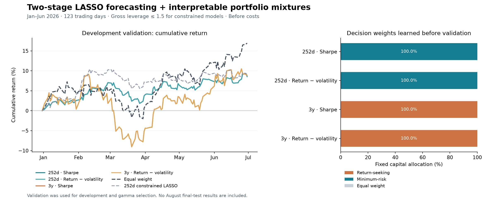

# 两阶段 LASSO 预测与线性组合决策实验

> 保留的三年窗口研究记录。清理后仅保留涉及三年训练、预测或风险窗口的研究产物；重复的纯 252 天回归对照已从结果目录和汇总表移除。正文与原图中的对照数值保留为当时的研究背景，当前 252 天结果请以[最新统一报告](unified-252-2026-09-22.md)为准。原始元数据/冻结配置未改写；历史审计记录描述清理前的完整实验，保留子集另有清理核验。


实验日期：2026-09-22。目标是把下一日收益预测与组合决策分开训练，在保持模型可解释性的同时，比较直接优化 Sharpe 和优化收益减波动两种决策目标。
本次使用原验证期进行开发比较和 gamma 选择，不能视为独立测试成绩。现有 CSV 截至 2026-07-31，尚无保留的八月测试数据。

## 模型与模块

预测层分别使用最近 252 个完整交易样本和至多三个日历年的历史，训练 98 个独立的线性 LASSO，训练观察值等权。
每个资产使用六个截至上一交易日可知的特征：前一日收益、过去 5/21/63 日复合收益、过去 21 日样本标准差、过去 21 日 EW 复合收益。
目标是资产下一日收益；这与旧模型通过最小方差回归直接求组合持仓不同。每次拟合的标准化器只接触该次训练数据，预测目标不标准化。

```text
Forecast loss = mean((next_return - intercept - X @ beta)^2) / 2
                + alpha * sum(abs(beta))
```

每种窗口共用一个 alpha，通过早期历史的 3 × 21 日时间顺序 CV，从 `logspace(-6, -2, 21)` 中选择平均 MSE 最低者；数值同分时选择更大的 alpha。
alpha 校准完成后冻结，各资产的系数和标准化参数仍每天用此前历史重新拟合。CV 每折只在折开始前拟合一次，折内各日使用当时已经实现的滞后特征做下一日预测。

风险模型独立使用此前至多三年的原始日收益，估计 Ledoit–Wolf 协方差矩阵。四种预测器（两种 LASSO 和对应的历史均值对照）共用同日风险矩阵。
每天构造三个候选组合：U 最大化预测收益，V 最小化估计方差，E 为等权组合。每个候选均满足：

```text
sum(w) = 1
sum(abs(w)) <= 1.5
w' @ Sigma @ w <= EW' @ Sigma @ EW
1 + historical_returns @ w >= 1e-6   (for every historical day)
```

风险上限约束估计风险，不保证未来实际波动一定低于 EW。历史财富下限也不是未来损失保证。
模型允许有限卖空。求解后重新检查每个候选和每个混合组合的可行性，不把失败的求解静默替换成 EW。

决策层只有三个固定系数，由历史样本外候选的实际收益训练：

```text
w_t = a * U_t + b * V_t + c * E
a >= 0, b >= 0, c >= 0, a + b + c = 1

Sharpe objective: maximize mean(r) / sample_std(r)
Return-volatility objective: maximize mean(r) - gamma * sample_std(r)
```

这些系数在整个决策训练期共同拟合，之后固定使用；随日期变化的是 U_t、V_t 和预测器系数。
三个候选的非负凸组合继续满足上述凸约束。收益减波动目标使用标准差，不是方差。
Sharpe 目标在存在正均值时通过凸变换求解；非正均值和退化风险有单独处理，避免直接使用不稳定的通用比值优化。
数值并列时优先接近 EW。能够证明主问题最优解唯一时直接使用该解，避免重复求解几乎没有内部空间的并列约束问题。

代码职责：

| 文件 | 职责 |
|---|---|
| `portfolio/forecasting.py` | 因果特征、时间顺序 CV、逐日 LASSO 预测 |
| `portfolio/candidates.py` | 风险估计、候选组合和硬约束验证 |
| `portfolio/decision.py` | 两类决策目标及三个组合系数的训练 |
| `portfolio/two_stage.py` | 时间边界、两阶段训练、基线比较和冻结测试 |
| `portfolio/two_stage_io.py` | 结果、冻结配置、数据和代码哈希导出 |
| `run_two_stage.py` | 命令行入口 |

复用现有 `TrainingConfig` 和 `TrainingWindow`，保留原 126 天、252 天和三年训练流程。
新预测 LASSO 的 alpha 惩罚六个预测特征系数；旧基线的固定 lambda=1e-5 惩罚最小方差回归系数，两者的对象和损失尺度不同，不能直接比较参数数值。
旧约束基线沿用其原有风险估计，新方法使用 Ledoit–Wolf；新旧模型比较反映整套方案的差异。判断预测器本身是否有帮助，应优先看共用同一决策与风险流程的历史均值对照。

## 时间划分与评价约定

| 阶段 | 时间 | 用途 |
|---|---|---|
| 历史池开始 | 2021-08-01（首条实际数据为 08-02） | 前 63 条观察用于特征预热 |
| 预测参数校准 | 截至 2024-07-31 | 最后三组 21 日折选择 alpha |
| 决策训练 | 2024-08-01 至 2025-12-31，356 日 | 用逐日样本外候选的实际收益拟合 a/b/c |
| 开发验证 | 2026-01-02 至 2026-06-30，123 日 | 选择 gamma，比较所有方法 |
| 保留测试 | 2026-08-01 至 2026-08-30 | 完整数据到齐后显式调用冻结测试入口 |

三个 CV 验证折为 2024-05-01 至 05-30、05-31 至 07-01、07-02 至 07-31。
gamma 只从预先声明的 `0, 0.025, 0.05, 0.1, 0.2` 中选择。每个 gamma 的 a/b/c 都只在决策训练期拟合，再按验证累计收益选择 gamma；数值同分优先较大 gamma。
验证不会重新拟合 a/b/c，也不会重新选择 alpha。过去已发生的验证日可以进入后续日期的滚动预测训练和风险估计，这是逐日可执行的更新。
候选收益虽然是样本外生成的，决策训练期的最终混合收益仍属于决策模型的样本内表现。

收益按实际持仓逐日重构，累计收益为复利，Sharpe 为日均收益除以日样本标准差（ddof=1），不扣无风险收益，不年化，不计交易成本。
换手率比较新持仓与上一日收益漂移后的持仓。全部结果使用同一组 98 个资产，沿用预处理入口删除指定两列的行为。

## 结果：四个新配置未显示整体优势

校准得到 252 天预测器 alpha=`0.002511886431509582`，三年预测器 alpha=`0.001584893192461114`。
以下均为同一 123 日验证区间。日波动和累计收益以百分数展示，最大回撤保留负号。

| 方法 | 累计收益 | 日 Sharpe | 日波动 | 最大回撤 | 平均总敞口 |
|---|---:|---:|---:|---:|---:|
| 新：252 天预测 + Sharpe 决策 | 8.57% | 0.1192 | 0.5748% | -4.87% | 1.500 |
| 新：252 天预测 + 收益减波动决策 | 8.57% | 0.1192 | 0.5748% | -4.87% | 1.500 |
| 新：三年预测 + Sharpe 决策 | 8.88% | 0.0592 | 1.3139% | -16.65% | 1.500 |
| 新：三年预测 + 收益减波动决策 | 8.88% | 0.0592 | 1.3139% | -16.65% | 1.500 |
| 旧：252 天 LASSO | 6.98% | 0.0995 | 0.5673% | -4.83% | 3.036 |
| 旧：252 天 LASSO + 约束 | 8.80% | 0.1223 | 0.5743% | -4.40% | 1.500 |
| 旧：三年 LASSO | 8.46% | 0.1192 | 0.5678% | -5.21% | 2.746 |
| 旧：三年 LASSO + 约束 | 7.76% | 0.1051 | 0.5951% | -5.33% | 1.500 |
| EW | 16.93% | 0.1325 | 0.9974% | -8.63% | 1.000 |

新 252 天方案相较旧 252 天约束版，累计收益低约 0.24 个百分点，波动相近，回撤略大。
新三年方案只比旧 252 天约束版多约 0.07 个百分点累计收益，却承担了明显更大的波动和回撤，不能把它概括为更好的模型。
EW 在这个验证期的累计收益和 Sharpe 仍领先；其实际日波动还低于新三年方案。
后者并未违反训练风险约束：每日估计风险受限，验证期实际实现的风险仍可能高于 EW。



## 决策层实际学到了什么

| 配置 | U 收益组合占比 | V 最小风险占比 | E 等权占比 | 选中 gamma |
|---|---:|---:|---:|---:|
| 252 天 + Sharpe | 约 0% | 约 100% | 约 0% | 不适用 |
| 252 天 + 收益减波动 | 约 0% | 约 100% | 约 0% | 0 |
| 三年 + Sharpe | 约 100% | 约 0% | 约 0% | 不适用 |
| 三年 + 收益减波动 | 约 100% | 约 0% | 约 0% | 0.05 |

完整精度保存于 `frozen_decisions.json`。小于 0.0004% 的分配来自数值容差及接近 EW 的并列处理，不应解读成有经济意义的混合。
两个训练目标在每种窗口下几乎选中了同一候选，因此图中两条对应曲线重合；本轮没有证明更换训练目标本身带来了改善。
252 天方案最终主要使用共同的 V，预测层几乎不影响最终持仓；三年方案选择 U，对预测驱动的持仓变化更敏感。
验证期平均每日换手率分别约为 **1.12%** 和 **18.45%**，本表未计交易成本。

三年预测器的 U 在决策训练期日 Sharpe 为 0.0965，验证期降为 0.0592。
时间顺序分割阻止了使用未来数据拟合，但无法保证固定决策系数能适应后续市场，训练阶段偏好的候选可能在验证阶段失去优势。

预先声明的网格中，三年方案 gamma=0.2 对应约 **30.79% U + 69.21% V**，验证累计收益 **8.83%**、日 Sharpe **0.1004**、日波动 **0.7105%**、最大回撤 **-7.09%**。
它只比被选中的 gamma=0.05 少约 **0.04 个百分点**累计收益，却大幅降低了风险。
按照既定的“验证累计收益最高”规则，它没有被选中；此处如实保留这一权衡，没有事后替换选择规则或选中配置。
gamma 为 0、0.025、0.05、0.1 时，三年模型的权重和成绩几乎相同；252 天的全部 gamma 也几乎都退化为 V。具体 gamma 数值不代表被精确识别出的最优风险偏好。

## 预测质量及历史均值对照

| 预测器 | 验证 MSE | 相对同窗口历史均值 MSE 变化 |
|---|---:|---:|
| 252 天 LASSO | 0.000201465320 | +0.2499%（较差） |
| 252 天历史均值 | 0.000200963173 | 对照 |
| 三年 LASSO | 0.000201134663 | -0.0013%（差异极小） |
| 三年历史均值 | 0.000201137217 | 对照 |

零收益预测的 MSE 为 0.000202279952。LASSO 相对零预测稍有改善，但相对历史均值没有显示出稳定、明显的预测增益。
以绝对误差小于 1e-12 为相同，验证期资产—日期预测中，252 天 LASSO 有 **90.34%**、三年 LASSO 有 **98.19%** 与对应历史均值一致。
这表明所选正则化下，预测大部分时候接近简单均值；不能仅凭引入了预测层就宣称模型预测更精准。

在相同风险与候选构造方式下，252 天 LASSO 的单独 U 累计收益为 9.48%，历史均值 U 为 11.63%；三年 LASSO U 为 8.88%，历史均值 U 为 7.67%。
两个历史均值对照的决策层均选择约 100% V，最终累计收益约 8.57%、日 Sharpe 0.1192。
三年 LASSO 的最终收益略高，但风险明显更大；其收益差异同时包含预测器变化和训练后决策系数变化，不能全部归因于预测精度。

## 可靠性检查

- 完整 **98 项自动测试**通过；独立审查员另行执行 32 项新模块测试，发现的数值和测试日期覆盖问题均已修复。
- 测试覆盖特征与训练时间边界、折内标准化、未来数据扰动、训练/验证隔离、决策系数冻结、两类目标的独立数值参考以及完整/缺失八月测试路径。
- **2395 条候选求解记录**全部为 Clarabel `optimal`。数值可行性允许的预算误差为 1e-8、总敞口超限为 1e-7、方差相对误差为 1e-6、历史财富下限误差为 1e-8。
- 独立脚本从原始收益与导出持仓复核 8 个模型、3832 个模型—日期，最大日收益重构差异 **1.10e-16**；验证指标最大差异 **1.29e-15**。
- 独立重算 24 个决策拟合目标，最大差异 **9.20e-17**；20 条策略的漂移后换手率最大差异 **2.98e-15**。
- 独立重估 20 条候选/最终持仓流的风险约束：最大预算误差 **4.33e-12**，总敞口最大超限 **4.68e-9**，最大方差/限额比 **1.000000000117**，历史财富下限无违反，均在求解容差内。
- 首个验证日的独立预测复算完全一致。四个旧基线的收益与权重共 8 个文件和上一轮结果完全一致。
- 开始运行时、结果元数据中及最终文件的 21 项代码哈希完全一致，原始数据哈希一致。独立核验详情见结果目录中的 `verification.json`。

这些检查支持实现与导出结果的一致性，不代表已经解决预测或决策层的过拟合。选参使用了本验证集，后续调整仍应保留完整开发记录，最后用冻结后的八月测试评价。

## 复现与输出

```bash
OPENBLAS_NUM_THREADS=1 OMP_NUM_THREADS=1 .venv/bin/python run_two_stage.py \
  --output results/window_studies_3y/forecast_mixture_20260922
```

输出目录必须为空或不存在。保存的内容包括预测、CV 分数、候选和最终持仓、逐日收益、求解诊断、每个 gamma 的训练系数与验证成绩、比较表、环境版本、数据/代码哈希以及 `frozen_decisions.json`。
原始数据 SHA-256 为 `11399a830c7b2a192d652b39e866a74c05d7380dd6edf1573ce1c40f9d271c23`。

默认入口始终排除八月数据。数据完整后，使用新目录运行：

```bash
OPENBLAS_NUM_THREADS=1 OMP_NUM_THREADS=1 .venv/bin/python run_two_stage.py \
  --csv 100_Portfolios_10x10_Daily.csv \
  --frozen results/window_studies_3y/forecast_mixture_20260922/frozen_decisions.json \
  --output results/two_stage_lasso_final_test
```

冻结入口检查历史指纹、资产顺序和八月 3 日至 28 日全部 20 个预期交易日，不重新选择 alpha、gamma 或拟合决策系数。合成数据覆盖了成功执行以及测试日期缺失时明确报错的路径；本次没有真实八月测试成绩。
