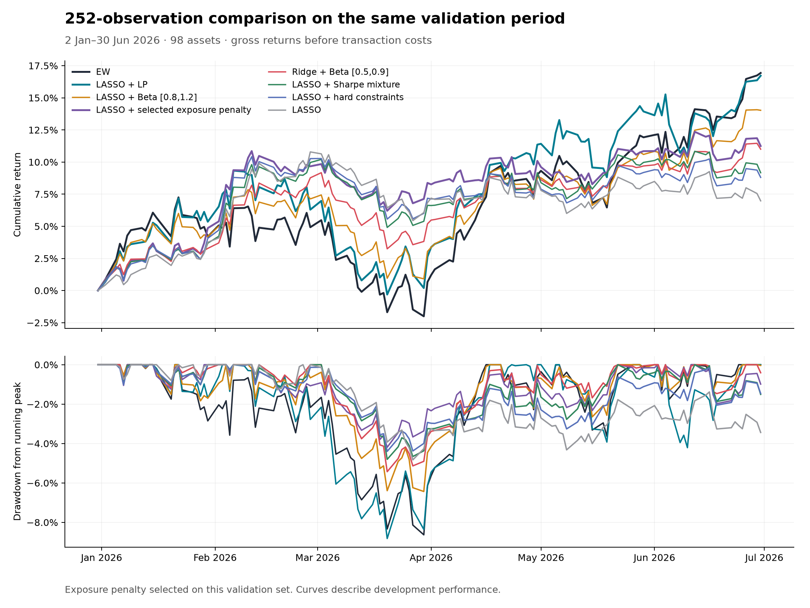

# 全模型 252 天统一窗口比较

运行日期：2026-09-22。八类现有实验全部重新运行，共 65 个结果条目，包含重复基准、候选组件和选参后别名；按照全期持仓逐元素差异小于 1e-10 去重后为 53 组数值不同的持仓。去重数量不是独立建模思想的数量，近似相同的凸优化解仍可能分别计数。

## 统一设置与比较边界

- 验证区间：**2026-01-02 至 2026-06-30，123 个交易日**，98 个资产。预处理首先删除 `ME9 BM10` 和 `BIG HiBM`；本轮涉及的 2021-08-02 至 2026-06-30 面板完整，无缺失值。
- 所有滚动回归、预测拟合和风险估计均使用此前 **252 个交易观测**。二阶段混合决策层另用 **2024-12-30 至 2025-12-31 的 252 个交易日**拟合组合系数；验证阶段不更新这些系数。LP 每日直接优化持仓，不需要独立训练决策系数。
- 原 126 天、三年、五年探索的配置和代码均保留。本轮将相应思路的窗口统一为 252 后比较；等权 LASSO、等权约束 LASSO 等相同配置只需作为同一基准运行。近期加权仍比较半衰期 126/252/504；半衰期是衰减速度，不是历史窗口长度。
- 预测模型的 252 指完整的监督训练目标数；最长 63 天滞后特征需要更早的原始数据作预热。预测 alpha 保留原先截至 2024-07-31 的 3×21 顺序验证；每折训练目标数仍为 252。历史校准期没有移入当前验证期。
- 只统一时间设置，保留各方法已有正则化强度、约束、搜索空间与求解策略。旧 `LASSO_CV/Ridge_CV` 保留五折 CV；前者按 MSE、后者按 RidgeCV 的默认 R² 评分。本轮未将它们改成时间顺序 CV。PCA Ridge 保留历史实现的 alpha 缩放，与核心 Ridge 的缩放不同。
- 日 Sharpe = 日收益均值 / 样本标准差（ddof=1），无风险收益设为零；累计收益按每日复利计算；最大回撤包含初始净值 1，表中以负数表示。全部未扣交易成本。换手率统一按漂移后的持仓计算，验证首日统一从 EW 起算。
- 这段验证数据已用于多轮开发和比较。† 表示本轮直接利用该验证期选参或使用所选参数作消融，不能将这些排名当作独立测试成绩。所有候选中挑出的“最好”也有事后选择偏差。八月最终测试未运行。

## 代表结果

| 模型 | 累计收益 | 日 Sharpe | 日波动 | 最大回撤 | 平均总敞口 |
|---|---:|---:|---:|---:|---:|
| EW | 16.93% | 0.1325 | 0.9974% | -8.63% | 1.000 |
| LP_LASSO_252d | 16.72% | 0.1284 | 1.0195% | -8.82% | 1.500 |
| LASSO_market_like_0.8_1.2 | 14.03% | 0.1390 | 0.7904% | -6.43% | 1.328 |
| LASSO_Selected † | 11.25% | 0.1472 | 0.6010% | -4.19% | 1.015 |
| Ridge_conservative_0.5_0.9 | 11.00% | 0.1511 | 0.5725% | -5.43% | 1.500 |
| LASSO_252d_Sharpe | 9.17% | 0.1282 | 0.5690% | -4.80% | 1.500 |
| LASSO_Constrained | 8.80% | 0.1223 | 0.5743% | -4.40% | 1.500 |
| LASSO | 6.98% | 0.0995 | 0.5673% | -4.83% | 3.036 |



累计收益最高的条目为 `EW`（16.93%）；日 Sharpe 最高的条目为 `Ridge_conservative_0.5_0.9`（0.1511）。收益、回撤、波动和杠杆没有由同一方法同时占优，不合成为人为的综合评分。

## 结果解读

1. **累计收益：EW 仍领先，LASSO + LP 最接近。** LP 的收益接近 EW，但日波动、回撤、杠杆和换手率均需一起考察；这轮结果没有显示它全面超过 EW。LP 中的回撤限制是训练历史上的非复利累计损益回撤代理，并不直接约束未来复利最大回撤。
2. **较高 Sharpe：保守 Beta Ridge 与软敞口惩罚 LASSO 表现突出。** 前者在较低日波动下取得较高 Sharpe；后者在收益、回撤和总敞口之间取得较好的本期组合。二者的回撤和杠杆结构不同，不能用 Sharpe 单独概括。
3. **收益奖励没有被本轮搜索保留。** 本轮最终 eta=0、gamma=2；因此联合模型与仅敞口惩罚消融相同。搜索停止原因为 `patience`，评价 12 组不同配置；不能把效果归因于未启用的收益奖励。
4. **硬约束仍优于普通 LASSO 的本期结果。** 普通 LASSO 的平均总敞口明显高于 1.5；加入硬约束后累计收益与 Sharpe 上升，最大回撤有所改善。日波动没有明显下降，改善不是每个风险指标都变好。
5. **Elastic Net 和 PCA 的增益有限。** Elastic Net 最好的比例接近纯 LASSO，本期小幅差距不足以说明稳定优势。PCA 最好的候选仍低于普通 LASSO 的收益和 Sharpe，扩大主成分数也没有单调改善。
6. **混合决策层主要选择最低方差组件。** LASSO 预测版本的 Sharpe 和收益减波动模型几乎都把权重给了 V，因此其表现不能作为预测信号有效的证据。历史均值预测的收益减波动版本更偏向 U，收益略高，但波动和回撤明显更大。
7. **近期加权没有超过等权约束基准。** 本轮在三种半衰期中选出 504 个交易日，累计收益 8.51%、日 Sharpe 0.1198，仍低于等权约束 LASSO 的 8.80% 和 0.1223。选择依据仍是当前验证期累计收益，选中模型不构成额外的独立实验。

## 全部结果

以下包括所有 65 个条目；不同实验中重复出现的 EW、LASSO 和消融对照故意保留，以便复查各实验。CSV 的 `equivalent_holdings` 指向持仓数值相同的先前条目。

### 基础回归与固定约束

| 模型 | 累计收益 | 日 Sharpe | 日波动 | 最大回撤 | 平均总敞口 |
|---|---:|---:|---:|---:|---:|
| EW | 16.93% | 0.1325 | 0.9974% | -8.63% | 1.000 |
| LASSO_Constrained | 8.80% | 0.1223 | 0.5743% | -4.40% | 1.500 |
| LASSO_LogGrowth | 8.07% | 0.1133 | 0.5716% | -4.51% | 1.500 |
| LASSO | 6.98% | 0.0995 | 0.5673% | -4.83% | 3.036 |
| LASSO_CV_Weighted | 6.48% | 0.0963 | 0.5452% | -4.89% | 3.177 |
| RidgeWeighted | 6.60% | 0.0923 | 0.5814% | -5.85% | 2.145 |
| Ridge_CV_Weighted | 5.20% | 0.0805 | 0.5298% | -5.60% | 3.612 |
| Ridge | 5.10% | 0.0778 | 0.5389% | -4.93% | 3.125 |
| LASSO_CV | 4.74% | 0.0659 | 0.5981% | -4.86% | 3.800 |
| Ridge_CV | 3.76% | 0.0568 | 0.5550% | -5.15% | 4.576 |
| MinVar | 2.94% | 0.0368 | 0.7074% | -4.61% | 8.921 |

### 收益奖励与敞口惩罚搜索

| 模型 | 累计收益 | 日 Sharpe | 日波动 | 最大回撤 | 平均总敞口 |
|---|---:|---:|---:|---:|---:|
| LASSO_Selected † | 11.25% | 0.1472 | 0.6010% | -4.19% | 1.015 |
| Selected_ExposureOnly † | 11.25% | 0.1472 | 0.6010% | -4.19% | 1.015 |
| EW | 16.93% | 0.1325 | 0.9974% | -8.63% | 1.000 |
| LASSO_Constrained | 8.80% | 0.1223 | 0.5743% | -4.40% | 1.500 |
| Selected_RewardOnly † | 8.80% | 0.1223 | 0.5743% | -4.40% | 1.500 |
| LASSO_LogGrowth | 8.07% | 0.1133 | 0.5716% | -4.51% | 1.500 |
| LASSO | 6.98% | 0.0995 | 0.5673% | -4.83% | 3.036 |

### 近期样本加权

| 模型 | 累计收益 | 日 Sharpe | 日波动 | 最大回撤 | 平均总敞口 |
|---|---:|---:|---:|---:|---:|
| LASSO_252d_Weighted_Selected † | 8.51% | 0.1198 | 0.5678% | -4.60% | 1.500 |
| LASSO_252d_HL504_Constrained | 8.51% | 0.1198 | 0.5678% | -4.60% | 1.500 |
| LASSO_252d_HL252_Constrained | 8.28% | 0.1180 | 0.5611% | -4.61% | 1.500 |
| LASSO_252d_HL126_Constrained | 7.73% | 0.1135 | 0.5467% | -4.55% | 1.500 |
| LASSO_252d_Weighted_HL252 | 6.99% | 0.1026 | 0.5500% | -4.79% | 2.958 |

### Elastic Net

| 模型 | 累计收益 | 日 Sharpe | 日波动 | 最大回撤 | 平均总敞口 |
|---|---:|---:|---:|---:|---:|
| ElasticNet_l1ratio_0.95 | 7.01% | 0.1001 | 0.5664% | -4.81% | 3.069 |
| ElasticNet_l1ratio_0.975 | 6.99% | 0.0998 | 0.5668% | -4.82% | 3.052 |
| ElasticNet_l1ratio_0.9 | 6.97% | 0.0997 | 0.5656% | -4.80% | 3.105 |
| ElasticNet_l1ratio_0.99 | 6.98% | 0.0996 | 0.5671% | -4.82% | 3.042 |
| ElasticNet_l1ratio_0.995 | 6.98% | 0.0996 | 0.5672% | -4.83% | 3.039 |
| ElasticNet_l1ratio_1 | 6.98% | 0.0995 | 0.5673% | -4.83% | 3.036 |
| ElasticNet_l1ratio_0.85 | 6.85% | 0.0982 | 0.5651% | -4.79% | 3.144 |
| ElasticNet_l1ratio_0.8 | 6.70% | 0.0961 | 0.5654% | -4.78% | 3.190 |
| ElasticNet_l1ratio_0.75 | 6.67% | 0.0954 | 0.5667% | -4.77% | 3.240 |
| ElasticNet_l1ratio_0.5 | 5.49% | 0.0786 | 0.5733% | -4.58% | 3.588 |
| ElasticNet_l1ratio_0.25 | 4.20% | 0.0605 | 0.5801% | -4.39% | 4.395 |

### 滚动 PCA

| 模型 | 累计收益 | 日 Sharpe | 日波动 | 最大回撤 | 平均总敞口 |
|---|---:|---:|---:|---:|---:|
| Ridge_PCA_15 | 6.08% | 0.0864 | 0.5742% | -4.93% | 3.607 |
| LASSO_PCA_15 | 5.84% | 0.0854 | 0.5587% | -4.59% | 3.192 |
| LASSO_PCA_10 | 5.34% | 0.0780 | 0.5625% | -4.40% | 3.148 |
| Ridge_PCA_10 | 4.70% | 0.0688 | 0.5655% | -4.39% | 3.457 |
| LASSO_PCA_20 | 3.85% | 0.0576 | 0.5610% | -4.64% | 3.295 |
| Ridge_PCA_20 | 3.63% | 0.0512 | 0.6021% | -5.00% | 3.948 |
| LASSO_PCA_5 | 3.17% | 0.0464 | 0.5840% | -5.53% | 2.904 |
| LASSO_PCA_3 | 3.29% | 0.0415 | 0.6911% | -6.83% | 2.616 |
| Ridge_PCA_5 | 2.70% | 0.0398 | 0.5879% | -5.50% | 3.025 |
| Ridge_PCA_3 | 2.93% | 0.0373 | 0.6933% | -6.85% | 2.686 |
| LASSO_PCA_30 | 2.33% | 0.0355 | 0.5723% | -4.86% | 3.375 |
| Ridge_PCA_30 | 0.66% | 0.0119 | 0.5944% | -5.64% | 4.459 |

### 市场 Beta 约束

| 模型 | 累计收益 | 日 Sharpe | 日波动 | 最大回撤 | 平均总敞口 |
|---|---:|---:|---:|---:|---:|
| Ridge_conservative_0.5_0.9 | 11.00% | 0.1511 | 0.5725% | -5.43% | 1.500 |
| LASSO_market_like_0.8_1.2 | 14.03% | 0.1390 | 0.7904% | -6.43% | 1.328 |
| LASSO_conservative_0.5_0.9 | 10.16% | 0.1372 | 0.5858% | -4.69% | 1.500 |
| Ridge_unconstrained | 9.81% | 0.1362 | 0.5705% | -5.43% | 1.500 |
| Ridge_market_like_0.8_1.2 | 13.44% | 0.1322 | 0.7995% | -6.26% | 1.225 |
| LASSO_unconstrained | 8.81% | 0.1224 | 0.5743% | -4.40% | 1.500 |

此处 `unconstrained` 仅指没有额外 Beta 上下界，仍有总敞口、历史方差和财富底线约束。Beta 相对同窗口的 EW 收益估计，不是外部市场指数。

### 二阶段混合决策

| 模型 | 累计收益 | 日 Sharpe | 日波动 | 最大回撤 | 平均总敞口 |
|---|---:|---:|---:|---:|---:|
| Mean_252d_E | 16.93% | 0.1325 | 0.9974% | -8.63% | 1.000 |
| LASSO_252d_E | 16.93% | 0.1325 | 0.9974% | -8.63% | 1.000 |
| LASSO_252d_ReturnVolatility † | 9.17% | 0.1282 | 0.5690% | -4.80% | 1.500 |
| Mean_252d_Sharpe | 9.17% | 0.1282 | 0.5690% | -4.80% | 1.500 |
| LASSO_252d_Sharpe | 9.17% | 0.1282 | 0.5690% | -4.80% | 1.500 |
| LASSO_252d_V | 9.17% | 0.1282 | 0.5690% | -4.80% | 1.500 |
| Mean_252d_V | 9.17% | 0.1282 | 0.5690% | -4.80% | 1.500 |
| Mean_252d_ReturnVolatility † | 10.24% | 0.0787 | 1.0813% | -9.88% | 1.500 |
| Mean_252d_U | 10.24% | 0.0787 | 1.0813% | -9.88% | 1.500 |
| LASSO_252d_U | 8.26% | 0.0646 | 1.0905% | -10.78% | 1.500 |

U 为预测收益最大化候选，V 为收缩协方差下的最低方差候选，E 为 EW。组件属于对照，不是额外训练出的混合模型。

### 二阶段直接 LP

| 模型 | 累计收益 | 日 Sharpe | 日波动 | 最大回撤 | 平均总敞口 |
|---|---:|---:|---:|---:|---:|
| EW | 16.93% | 0.1325 | 0.9974% | -8.63% | 1.000 |
| LP_LASSO_252d | 16.72% | 0.1284 | 1.0195% | -8.82% | 1.500 |
| LP_Mean_252d | 16.10% | 0.1236 | 1.0252% | -9.41% | 1.500 |

## 独立核验

- 八个进程全部成功完成；进一步检查了参数搜索的比较状态与失败记录，未用进程退出码替代模型级核验。
- 每个条目均对齐同样的 123 个日期和 98 列资产。用原始资产收益与导出持仓重新计算每日收益和全部核心指标，最大收益重构误差 1.71e-16，最大指标误差 1.92e-15，最大持仓和偏差 3.2e-13。
- 对导出的训练计数和历史截止日进行核验；对约束模型逐日重新计算训练风险、总敞口、财富底线、Beta 上下界及 LP 单资产/MAD/历史回撤限制。各项在既定数值容差内通过。市场 Beta 历史求解器允许 optimal_inaccurate，本轮没有依靠该标记替代实际可行性检查。
- 数据哈希与八类运行时记录一致，代码哈希与当前源文件一致。使用的是当前已重构、尚未提交的工作区代码，因此仅凭 HEAD 不能完整复现；元数据保存了逐文件源码哈希。
- 独立 agent 审查了方法覆盖、252 观测设置和信息时序，并指出换手率起点差异；统一汇总已修正此口径，未修改原始实验产物。

数据 SHA-256：`11399a830c7b2a192d652b39e866a74c05d7380dd6edf1573ce1c40f9d271c23`。

## 保存位置与复现

- 本报告的完整数值表：[unified-252-2026-09-22.csv](unified-252-2026-09-22.csv)。指标数值保存为小数，百分比仅用于展示。
- 本次运行根目录：`results/unified_252/20260922T122949.119118Z/`。
- 根目录 `metrics/` 包含按 Sharpe / 累计收益排序的总表、去重表及分组摘要；`returns/validation_returns.csv` 包含统一验证期每日收益；`diagnostics/reconstruction_checks.csv` 包含每个条目的独立核验。
- 每个实验族子目录保留 `metrics/returns/weights/predictions/diagnostics/config/search` 中实际产生的内容和清单；根目录 `logs/` 保存完整日志，`config/` 保存状态、数据审计和本轮脚本。
- `turnover-252.md`、`smoothness-252.md`、`shrinkage-252.md` 对应的独立运行代码当前缺失，故没有将历史报告数字混入本轮排名。二阶段风险估计中已有的 Ledoit-Wolf 收缩正常运行。原教学脚本归档不是额外维护模型，其基础方法已被框架覆盖。
- 原来的 126/252 天与多年配置、历史结果目录均未覆盖或删除。本轮没有修改模型算法，也没有提交或推送。

用本次保存的 runner 为指定实验族创建一个全新的结果目录，例如：

```bash
OPENBLAS_NUM_THREADS=1 OMP_NUM_THREADS=1 MKL_NUM_THREADS=1 VECLIB_MAXIMUM_THREADS=1 NUMEXPR_NUM_THREADS=1 \
.venv/bin/python results/unified_252/20260922T122949.119118Z/config/run_family.py \
  --project "$PWD" --family lp --output results/unified_252/lp_reproduction
```

可用实验族：`baselines`、`loss_search`、`recency`、`elastic_net`、`pca`、`market_beta`、`mixture`、`lp`。需保留本轮元数据中的相同数据和源码版本，复现目录必须为空或尚不存在。原始大型产物按仓库设置位于忽略的 `results/`；报告、简表和图片可单独纳入后续提交。
