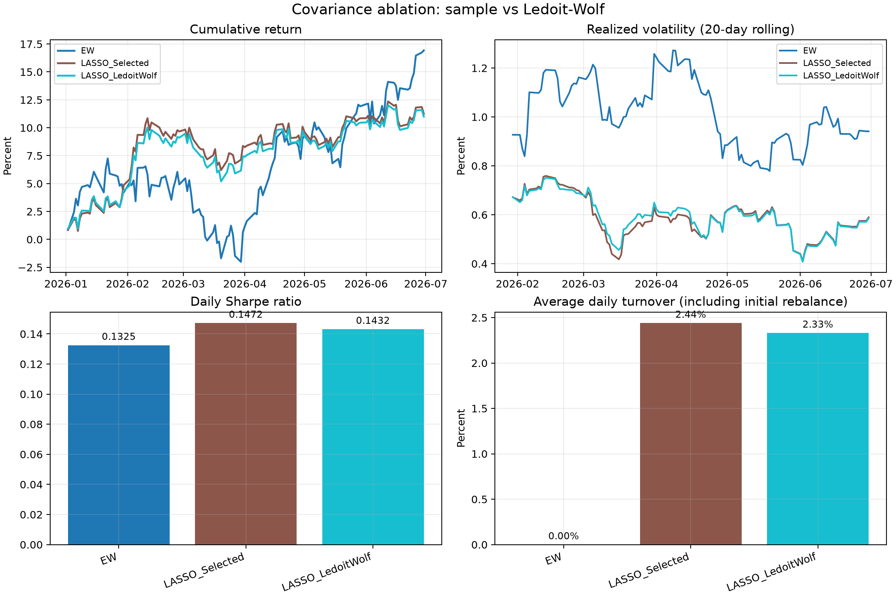

# Ledoit-Wolf Covariance Shrinkage Ablation

Experiment date: 2026-09-19. This is a development/validation ablation, not an independent final-test result.

## Motivation and framework

With 98 assets and 252 observations per rolling window, the sample covariance matrix can contain substantial estimation noise. This experiment changes only the risk estimator inside the latest selected model. It is not a standalone minimum-variance portfolio.

| Component | Design |
|---|---|
| Data | Estimate one covariance matrix from each causal 252-day training window |
| Loss | Replace sample variance with `w' Sigma_LW w` |
| Structure | Keep `w = EW - N @ beta`, LASSO lambda=1e-5 and exposure gamma=2 |
| Constraints | Keep full investment, gross leverage <= 1.5, wealth >= 1e-6 and volatility <= EW |

Ledoit-Wolf uses:

```text
Sigma_LW = (1 - delta) * S + delta * mu * I

Loss = w' Sigma_LW w
       + 1e-5 * ||beta||_1
       + 2 * (EW' Sigma_LW EW) * exposure_unit_penalty(w)
```

The same covariance estimator is used in the variance loss, EW scaling and volatility constraint. The shrinkage intensity `delta` is estimated from each training window by the Ledoit-Wolf formula; it is not tuned on validation performance. All return-reward, turnover and grid-smoothness coefficients remain zero.

## Evaluation design

- Validation period: 2026-01-02 to 2026-06-30, 123 trading days.
- Every daily fit uses only the preceding 252 observations.
- `LASSO_Selected` uses the original sample covariance.
- `LASSO_LedoitWolf` changes only the covariance estimator.
- Returns exclude transaction costs and a risk-free rate. Daily Sharpe is not annualized.
- The reserved period beginning 2026-08-01 was not evaluated.

## Results

| Strategy | Cumulative return | Daily Sharpe | Daily volatility | Max drawdown | Average turnover | Average gross leverage |
|---|---:|---:|---:|---:|---:|---:|
| EW | 16.93% | 0.1325 | 0.9974% | -8.63% | 0.00% | 1.000 |
| Selected LASSO: sample covariance | **11.25%** | **0.1472** | **0.6010%** | **-4.19%** | 2.44% | 1.015 |
| Selected LASSO: Ledoit-Wolf | 11.00% | 0.1432 | 0.6057% | -4.38% | **2.33%** | 1.015 |



The estimated shrinkage intensity averages 3.34% across the 123 fits, with a range from 1.47% to 4.75%. Thus, the estimator makes a modest rather than extreme change to the covariance matrix.

## Interpretation

Ledoit-Wolf does not improve the present validation result. Relative to the frozen sample-covariance model, cumulative return falls by 0.245 percentage points, Sharpe falls by 2.76%, realized volatility rises by 0.78%, and maximum drawdown worsens by 0.186 percentage points. Average turnover falls by 4.48%, so the holdings are slightly more stable, but this benefit is insufficient to offset the weaker return-risk outcome.

This does not show that covariance shrinkage is generally ineffective. It shows that, conditional on the current LASSO, exposure penalty and constraints, replacing the sample covariance with the standard Ledoit-Wolf target does not add value in this validation period. One possible explanation is that the existing regularizers already remove much of the covariance noise, while shrinkage also removes some useful cross-asset correlation information.

Under the course metric of negative daily Sharpe, the sample-covariance specification remains the selected model. Keeping it avoids adopting a theoretically attractive component after it fails the matched ablation.

## Verification and reproduction

- All 66 automated tests pass. Five new tests cover invalid estimators, exact sample-mode equivalence, an independent Ledoit-Wolf covariance/scalar optimum, future-data isolation, and end-to-end exports.
- All 246 daily convex fits returned `optimal` with Clarabel; no fallback or EW replacement was used.
- Recomputed cumulative return, Sharpe and weight-sum errors are below `1.6e-15`.
- Maximum fitted-risk/EW-risk ratios are 0.452 for sample covariance and 0.470 for Ledoit-Wolf; all hard constraints are satisfied.
- Data SHA-256: `11399a830c7b2a192d652b39e866a74c05d7380dd6edf1573ce1c40f9d271c23`.

Run from a new or empty output directory:

```bash
python -m pip install -r requirements.txt
python -m unittest discover -s tests -v
python run_shrinkage.py --csv /path/to/100_Portfolios_10x10_Daily.csv \
  --output results/shrinkage_252
```

The output contains `summary.csv`, daily returns, weights, turnover, solver/risk diagnostics, the comparison figure, and `run_metadata.json` with data/code hashes and package versions.
