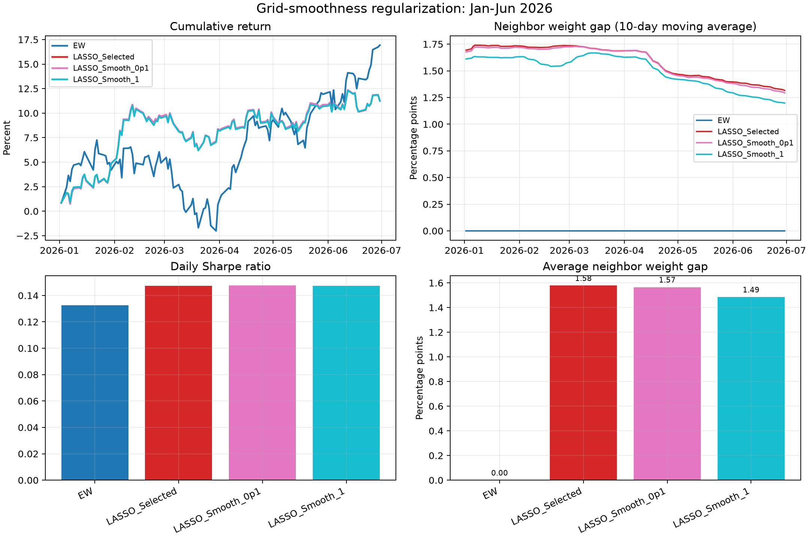

# Size-BM Grid-Smoothness Regularization

Experiment date: 2026-09-19. This is a development/validation sensitivity test, not an independent final-test result.

## Motivation and framework

The 100 portfolios are not unrelated assets: they occupy a 10 by 10 grid formed by size and book-to-market ranks. The latest model does not use this economic relationship. This experiment adds one structural assumption: portfolios next to each other on that grid should not receive very different weights unless the data provide enough evidence.

| Component | Design |
|---|---|
| Data | 98 equal-weighted size/book-to-market portfolios; causal 252-day rolling windows |
| Loss | Existing variance, LASSO and exposure terms, plus an adjacent-weight penalty |
| Structure | Keep `w = EW - N @ beta`; connect available horizontal and vertical Size-BM neighbors |
| Constraints | Keep full investment, gross leverage <= 1.5, training volatility <= EW, and wealth >= 1e-6 |

After removing `ME9 BM10` and `BIG HiBM`, the graph has 98 nodes and 176 valid edges. No connection is drawn across a missing portfolio. For trading day t, the added loss is:

```text
grid_gap(w_t) = mean(|w_t,i - w_t,j| for (i,j) in neighbor edges)

Loss_t = variance(R @ w_t)
         + 1e-5 * ||beta||_1
         + 2 * variance(R @ EW) * exposure_unit_penalty(w_t)
         + rho * variance(R @ EW) * grid_gap(w_t)
```

Using the mean rather than the sum prevents the penalty scale from depending arbitrarily on the number of graph edges. The values `rho in {0, 0.1, 1}` were fixed for this sensitivity check; lambda, eta, gamma, window length and all constraints were held constant.

## Evaluation design

- Validation period: 2026-01-02 to 2026-06-30, 123 trading days.
- Every fit uses only the preceding 252 observations.
- `rho=0` reproduces the latest selected model.
- Returns exclude transaction costs and a risk-free rate. Daily Sharpe is not annualized.
- The reserved period beginning 2026-08-01 was not evaluated.

## Results

| Strategy | Cumulative return | Daily Sharpe | Daily volatility | Max drawdown | Average neighbor gap | Average gross leverage |
|---|---:|---:|---:|---:|---:|---:|
| EW | 16.93% | 0.132533 | 0.9974% | -8.63% | 0.000 pp | 1.000 |
| Selected LASSO, rho=0 | 11.248% | 0.147231 | 0.6010% | -4.191% | 1.578 pp | 1.015 |
| Smooth LASSO, rho=0.1 | **11.275%** | **0.147513** | 0.6012% | -4.191% | 1.566 pp | 1.015 |
| Smooth LASSO, rho=1 | 11.241% | 0.147227 | **0.6006%** | **-4.132%** | **1.485 pp** | 1.015 |



## Interpretation

`rho=0.1` is directionally better, but the improvement is very small: cumulative return rises by only 0.027 percentage points and Sharpe rises by 0.000282, while the average neighbor gap falls by 0.8%. This is below the earlier 0.2-percentage-point material-improvement threshold and is not strong evidence of a durable performance gain.

`rho=1` reduces the neighbor gap by 5.9% and improves maximum drawdown by 0.059 percentage points, while Sharpe is effectively unchanged. This shows that the structural penalty works mechanically without causing the large performance deterioration seen with strong turnover regularization. However, it still does not establish model dominance.

The most plausible interpretation is that the existing LASSO and `gamma=2` exposure penalty have already shrunk the portfolio close to EW, leaving limited noise for grid smoothing to remove. Because the same January-June validation period has already informed model development, `rho=0.1` should be treated as a candidate for the reserved test, not as a confirmed replacement. The current selected model remains `rho=0` until an untouched period supports the change.

## Verification and reproduction

- All 61 automated tests pass. Seven new tests cover graph construction, invalid inputs, exact `rho=0` equivalence, an independent scalar optimum, monotonic smoothing, and end-to-end exports.
- All 369 daily convex fits returned `optimal` with Clarabel; no fallback or EW replacement was used.
- Recomputed return, Sharpe, graph-gap and weight-sum errors are below `2.3e-15`.
- Maximum training variance/EW-variance ratios are 0.452, 0.452 and 0.454 for rho 0, 0.1 and 1; all other hard constraints are also satisfied.
- Data SHA-256: `11399a830c7b2a192d652b39e866a74c05d7380dd6edf1573ce1c40f9d271c23`.

Run from a new or empty output directory:

```bash
python -m pip install -r requirements.txt
python -m unittest discover -s tests -v
python run_smoothness.py --csv /path/to/100_Portfolios_10x10_Daily.csv \
  --output results/smoothness_252
```

The output contains `summary.csv`, daily returns, weights, neighbor-gap series, solver diagnostics, the comparison figure, and `run_metadata.json` with data/code hashes and package versions.
