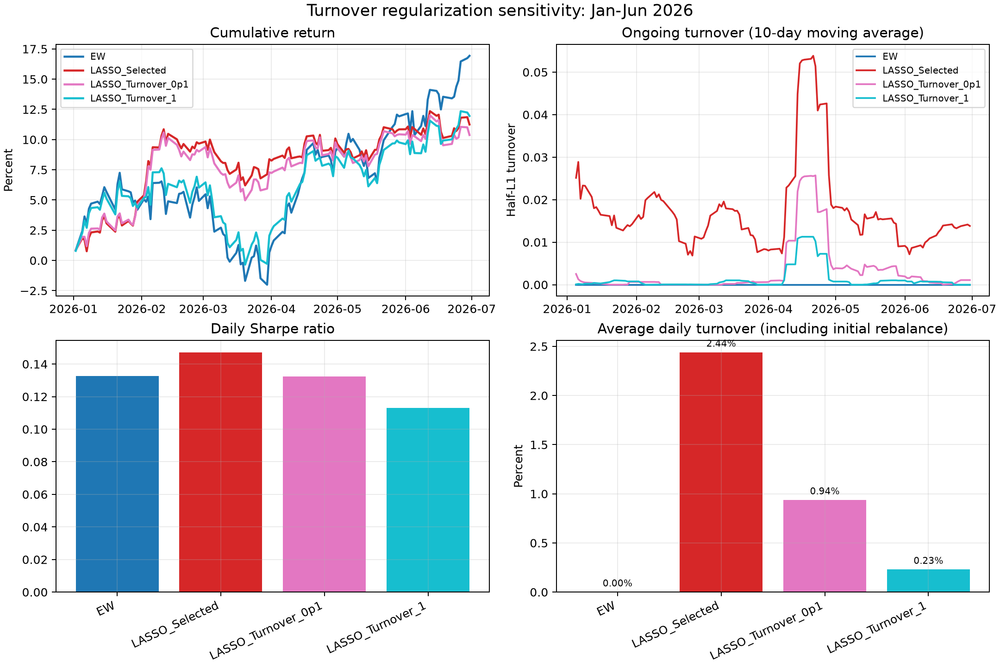

# Turnover-Regularized LASSO: Prespecified Sensitivity Test

Experiment date: 2026-09-19. This is a development/validation sensitivity test, not an independent final-test result.

## Motivation and framework

The latest selected model already controls estimation error through LASSO and controls portfolio shape through exposure and hard constraints. This experiment makes one focused change: it adds a penalty for changing the portfolio too much from the previous trading day.

This follows the course's data + loss + structure + constraint framework:

| Component | Design |
|---|---|
| Data | 98 equal-weighted size/book-to-market portfolios; causal 252-day rolling windows |
| Loss | Existing variance, LASSO and exposure terms, plus a turnover penalty |
| Structure | Keep `w = EW - N @ beta`; carry only the previous target holding into the next fit |
| Constraints | Keep full investment, gross leverage <= 1.5, training volatility <= EW, and wealth >= 1e-6 |

For trading day t, the added term is:

```text
turnover_t = 0.5 * ||w_t - w_(t-1)||_1

Loss_t = variance(R @ w_t)
         + 1e-5 * ||beta||_1
         + 2 * variance(R @ EW) * exposure_unit_penalty(w_t)
         + tau * variance(R @ EW) * turnover_t
```

The EW variance scales the new term to the existing objective. The first previous holding is EW. The values `tau in {0, 0.1, 1}` were fixed before this comparison; lambda, eta, gamma, window length and all constraints were held constant. Therefore, the test isolates one modelling idea rather than launching another broad parameter search.

## Evaluation design

- Validation period: 2026-01-02 to 2026-06-30, 123 trading days.
- Each portfolio uses only the preceding 252 observations.
- `tau=0` reproduces the latest selected model.
- Turnover is half-L1 target-weight turnover; its average includes the initial move from EW.
- Returns exclude transaction costs and a risk-free rate. Daily Sharpe is not annualized.
- The reserved period beginning 2026-08-01 was not evaluated.

## Results

| Strategy | Cumulative return | Daily Sharpe | Daily volatility | Max drawdown | Average turnover | Average gross leverage |
|---|---:|---:|---:|---:|---:|---:|
| EW | 16.93% | 0.1325 | 0.9974% | -8.63% | 0.00% | 1.000 |
| Selected LASSO, tau=0 | 11.25% | **0.1472** | **0.6010%** | **-4.19%** | 2.44% | 1.015 |
| Turnover LASSO, tau=0.1 | 10.38% | 0.1325 | 0.6209% | -5.07% | 0.94% | 1.014 |
| Turnover LASSO, tau=1 | **11.96%** | 0.1132 | 0.8428% | -7.41% | **0.23%** | 1.013 |



## Interpretation

The penalty improves holding stability, but not the current no-cost validation objective. At `tau=0.1`, average turnover falls by 61.6%, from 2.44% to 0.94% per day. However, cumulative return falls by 0.87 percentage points and daily Sharpe falls by 10.0%. At `tau=1`, turnover falls by 90.6% and cumulative return is 0.71 percentage points above the unpenalized model, but volatility and drawdown increase enough to reduce Sharpe by 23.1%.

The result is therefore a trade-off, not evidence that the new model dominates. A strong penalty makes the portfolio slow to react when the rolling window changes. A moderate penalty produces much smoother holdings, which could matter after transaction costs, but those costs were not measured here. Under the course metric of negative daily Sharpe, `tau=0` remains the selected specification. Retaining it avoids choosing a parameter after seeing this validation period.

This experiment still strengthens the analysis: it tests a clear overfitting mechanism, holds the rest of the model fixed, reports a failed performance hypothesis honestly, and shows that lower turnover alone does not imply better out-of-sample risk-adjusted performance.

## Verification and reproduction

- All 54 automated tests pass. Five new tests cover invalid tau values, exact `tau=0` equivalence, an independent two-asset scalar optimum, turnover monotonicity, and end-to-end exports.
- All 369 daily convex fits returned `optimal` with Clarabel; no fallback or EW replacement was used.
- Recomputed return, Sharpe, turnover and weight-sum errors are below `2.4e-15`.
- Maximum training variance/EW-variance ratios are 0.452, 0.468 and 0.838 for tau 0, 0.1 and 1; the gross-leverage limit is also satisfied.
- Data SHA-256: `11399a830c7b2a192d652b39e866a74c05d7380dd6edf1573ce1c40f9d271c23`.

Run from a new or empty output directory:

```bash
python -m pip install -r requirements.txt
python -m unittest discover -s tests -v
python run_turnover.py --csv /path/to/100_Portfolios_10x10_Daily.csv \
  --output results/turnover_252
```

The output contains `summary.csv`, daily returns, weights, turnover, solver diagnostics, the comparison figure, and `run_metadata.json` with data/code hashes and package versions.
